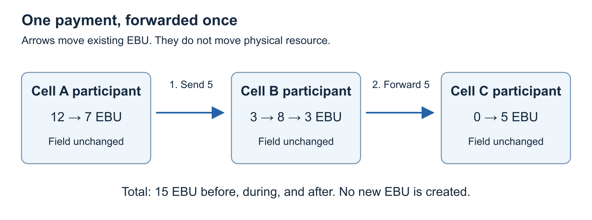
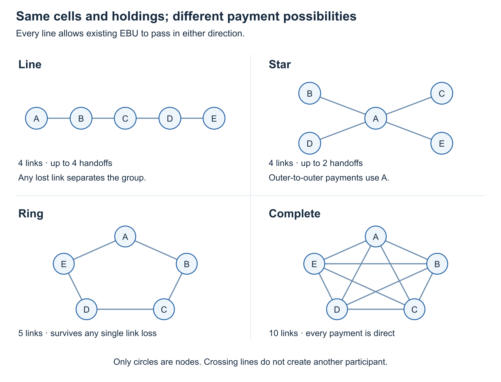
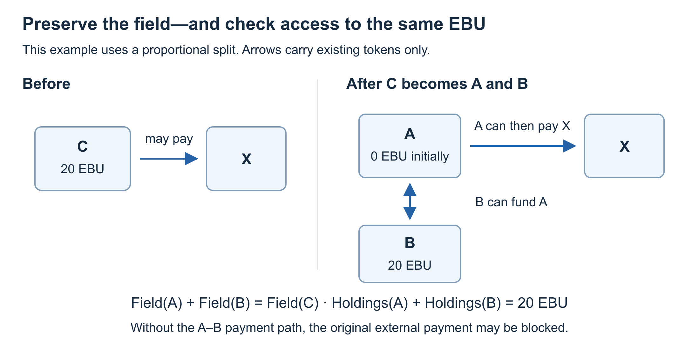

# EBU between economic cells
## A study of payments, cooperation, topology, division, and conservation

10 November 2026. A theoretical companion to [EBU economic cells: a study book](EBU_ECONOMIC_CELLS.md).

This study keeps the independent quadratic cells. Its new question is what happens when **the lines between cells represent transfers of existing EBU**.

The results below are proved consequences of explicit ideal assumptions, together with clearly labelled comparisons to physics. They are not an independently audited new foundation. No simulation, framework implementation, or imposed transaction fee is introduced. The owner-requested extension in Chapters 25–36 examines allocation, Fibonacci growth, and spiral hypotheses. Chapter 32 includes a separately labelled prescribed-delivery-rate example; it does not change the field or assume an automatic law of actor behaviour.

The continuation in Chapters 37–39 includes the reorganisation process in the comparison. It proves a local receiving optimum and a conditional route from repeated two-predecessor availability to a golden limiting ratio. It explicitly retains equal-size merging as a competing optimum and does not claim universal golden superiority.

## Central milestone: cell division can be chosen to fit resource operations

**Allocation milestone achieved within the stated quadratic model.** When one cell is divided proportionally before specified positive deliveries, the division giving the greatest complete EBU contribution assigns each piece a fraction equal to its share of the deliveries:

\[
\boxed{\alpha_i=\frac{q_i}{\sum_jq_j}.}
\]

Here \(q_i\) is the actual delivery amount specified for piece \(i\), and \(\alpha_i\) is its fraction of the original cell. Its resource, reference, and response are divided together according to the existing split law. The division itself creates no EBU. The benefit comes from how well the resulting cells fit the subsequent resource changes.

This is saved as a central research result requested by the owner on 10 November 2026. It is a conditional allocation theorem, not a claim that all economic goals have been achieved. Chapters 26–28 give the full proof, an exact numerical case, the many-cell extension, and important limits. Chapters 29–35 connect it to funding, graph growth, physical geometry, and the role of a future Python study.

For the new material, start with [the allocation problem](#25-what-problem-did-we-actually-solve), then follow Chapters 26–28 in order. Chapter 27 contains the complete numerical example. Chapters 30–31 separate Fibonacci sizes from Fibonacci payment graphs; Chapter 33 explains the physical question behind a possible spiral.

For the later question “does the process of local growth give a golden arrangement an EBU advantage?”, read Chapters 37–39. Their assumptions and conclusion differ from the fixed-delivery division theorem above.

## The picture in one paragraph

Each cell has its own resource amount and imbalance field. People change those amounts and receive the corresponding signed EBU contributions. People can also pass existing EBU to each other. A graph tells us which payments are possible directly, and which need intermediaries. The field determines the contribution of a resource action; the payment graph helps determine who can fund that action and share its benefit. These two parts can work together while remaining mathematically distinct.

## Reading route

We begin with A, B, and one payment. We then add an intermediary, a group boundary, and a funding problem. Only after that do we compare large topologies and study split–merge operations. The last chapters connect the graph to incentives, shortest paths, recursion, and the existing physical analogies.

| Part | Chapters | Main question |
|---|---|---|
| I | 1–4 | What moves on an EBU edge, and what is conserved? |
| II | 5–9 | Which actions can the graph help fund? |
| III | 10–14 | Which topologies are strong, and in what sense? |
| IV | 15–17 | What happens when cells split, merge, or grow? |
| V | 18–22 | What follows for incentives, paths, physics, and recursive designs? |
| VI | 23–24 | What has been established, and what is the next precise step? |
| VII | 25–28 | How should a cell be divided to fit specified resource operations? |
| VIII | 29–32 | How do allocation, payments, Fibonacci graphs, and external deliveries fit together? |
| IX | 33–36 | What could produce a spiral, which laws remain exact, and when would Python help? |
| X | 37–39 | What happens when we include local preparation and repeated availability of cell sizes? |

# Part I. One payment, then a graph

## 1. We keep the cell exactly as it is

For cell \(i\),

\[
\Phi_i(x_i)=\frac12K_i(x_i-x_i^*)^2,
\qquad
m_i=K_i(x_i-x_i^*).
\]

Here \(x_i\) is the represented resource amount in joules, \(x_i^*\) its reference amount, \(K_i>0\) the response in inverse joules, and \(m_i\) the current field slope. The slope is dimensionless because it is field joules per resource joule.

For an identified small change,

\[
dE=-\frac{m_i\,dx_i}{W_{\mathrm{Cs}}},
\qquad
W_{\mathrm{Cs}}
=6.091102297113866550\times10^{-24}\ {\rm J}.
\]

The cesium ruler stays fixed. A larger network does not rescale it.

The total field is

\[
\Phi_{\rm total}=\sum_i\Phi_i.
\]

This sum describes the collection. It does not make A's slope depend on B's amount. If only B changes, A's local field remains unchanged.

### What does a node own?

The user proposed cells as nodes. We use that picture and attach to each node the EBU balance of its operating participant or group. Call that balance \(b_i\), measured in EBU.

This is a drawing convention, not a claim that a tank literally owns money. For the basic examples, each participant operates one cell. If one participant operates several cells, their holdings must be allocated once across the drawing or represented by a separate participant node. The same balance cannot appear as independently available at every cell they operate.

Physical attribution remains attached to the person or group that actually made the identified contribution. Operating a cell does not automatically entitle someone to every contribution made there.

### What is an edge?

An arrow \(A\to B\) means that the participant at A can transfer existing EBU directly to the participant at B in the arrangement being studied.

A two-way line permits both directions. A missing line means that this direct payment is not available in the particular plan. It is not a proposed EBU rule forbidding people from making new agreements.

If everyone can already pay everyone directly, the appropriate graph is complete. Studying a sparse graph is useful only when we explicitly mean a limited set of available relationships, participants, permissions, or agreed routes.

**Principle check.** Nodes retain their original fields. Edges introduce no automatic physical coupling, issuance, or fee.

## 2. A payment changes holdings, not the cell

Suppose A's participant holds 12 EBU and B's holds 3 EBU. A pays B 5 EBU.

Afterward their balances are 7 and 8. The total remains 15.

Their cell amounts have not changed. Neither has either field:

\[
\Delta x_A=\Delta x_B=0,
\qquad
\Delta\Phi_A=\Delta\Phi_B=0.
\]

This small example describes all pure payments. For a transfer \(p\geq0\),

\[
b_A'=b_A-p,\qquad b_B'=b_B+p.
\]

The sender needs the existing available amount when the transfer is made. A promise to earn it later is not the same balance.

### Law 1. Payment conservation

Any sequence of transfers of existing EBU preserves their total:

\[
G=\sum_i b_i.
\]

**Proof.** Each transfer subtracts and adds the same amount. Adding these changes across all participants gives zero. Repeating a zero-total change does not alter the total.

The result holds for large or small payments, any number of participants, and any route. It does not depend on intelligent decisions.

### The physical connection

The mathematical counterpart is local conservation: a quantity leaving one place appears at another. Charge conservation is a useful physical example. Its continuity statement includes accumulation inside a region, not just equal incoming and outgoing quantities. See [Feynman, Volume II, section 13–2](https://www.feynmanlectures.caltech.edu/II_13.html).

The comparison concerns the balance structure. We have not assigned EBU an electric charge or made cell slopes into voltages driving payments.

**Principle check.** A payment does not count as another resource contribution. No second credit is awarded for carrying the same EBU onward.

## 3. Add all simultaneous payments without losing their meaning

For a finite payment plan, let \(p_e\) be the amount sent on directed edge \(e\). Let \(c_i\) be the signed contribution actually posted to participant \(i\) from the identified resource operations under comparison.

At each node,

\[
\boxed{
b_i'=b_i
+\sum_{e\ {\rm entering}\ i}p_e
-\sum_{e\ {\rm leaving}\ i}p_e
+c_i.
}
\]

Read this as: ending balance equals starting balance plus incoming payments minus outgoing payments plus actual signed contributions.

For compact proofs, define the incidence matrix \(\mathsf D\). Each edge has a column with \(-1\) at its sender, \(+1\) at its receiver, and zero elsewhere. Then

\[
\boldsymbol b'=\boldsymbol b+\mathsf D\boldsymbol p+\boldsymbol c.
\]

Every column sums to zero. That single property is why internal transfers disappear when we add all accounts.

### Law 2. Complete field–account conservation

If the complete resource change has been identified once and its matching contributions satisfy

\[
W_{\mathrm{Cs}}\sum_i c_i=-\Delta\Phi_{\rm total},
\]

then

\[
\boxed{
W_{\mathrm{Cs}}G'+\Phi_{\rm total}'
=W_{\mathrm{Cs}}G+\Phi_{\rm total}.
}
\]

**Proof.** Sum the node equation. Payment terms cancel, so \(G'-G=\sum_i c_i\). Multiply by \(W_{\mathrm{Cs}}\) and use the contribution identity.

Graph shape does not appear in this proof. A line, a ring, and a million-node graph obey the same complete balance.

### What about parallel resource actions?

Write each actor's identified change to cell \(i\) as \(dx_i^{(a)}\), with

\[
dx_i=\sum_a dx_i^{(a)}.
\]

Using the same current slope for all these contributions,

\[
\sum_a dE_a
=-\frac1{W_{\mathrm{Cs}}}
\sum_i m_i\sum_a dx_i^{(a)}
=-\frac{d\Phi_{\rm total}}{W_{\mathrm{Cs}}}.
\]

Integrating along actual changes gives the complete identity. Attribution can depend on how the contributions occur; the complete total remains exact. Any passive or other represented change must also appear once in the complete sum.

The owner's present working ideal posts the exact contribution after the action. This study uses that ideal. Historical accepted-before-completion rules are not revised here.

### A payment plan is not automatically an executable sequence

The matrix equation describes total amounts. It does not prove that every proposed ordering can be paid.

For example, three participants each start with zero and each promises to send 5 EBU around a directed triangle. The net balance equation ends at zero everywhere. Yet no first payment can occur using existing holdings.

We therefore distinguish a balanced plan from a sequence funded at each payment. The later constructive proofs provide such a sequence where they claim one exists. Atomic cancellation of debts would be another account model, not something silently assumed here.

**Principle check.** Conservation holds for simultaneous identified contributions, but it does not excuse double-spending or create starting funds.

## 4. Put a boundary around a group

Let \(S\) be a group of nodes. Write \(b_S=\sum_{i\in S}b_i\) and \(c_S=\sum_{i\in S}c_i\).

Adding the node equations inside the group gives

\[
\boxed{
b_S'-b_S
=c_S+P_{\rm into\ S}-P_{\rm out\ of\ S}.
}
\]

Payments between two members of \(S\) cancel. Only payments crossing the group's boundary remain.

### Law 3. Group-boundary balance

Internal circulation cannot increase a group's total holdings. An increase must come from its posted contributions or a net payment from outside.

**Proof.** Every internal edge appears once with each sign in the group sum.

This is the finite-amount form of a continuity balance. No clock, speed, or differential equation in time is needed.

### Can we also give each group its own field-and-token invariant?

Yes, with an additional matching condition. If the contributions posted to this group's participants are exactly the negative change of this group's cell fields divided by \(W_{\mathrm{Cs}}\), then

\[
\Delta\!\left(W_{\mathrm{Cs}}b_S+\Phi_S\right)
=W_{\mathrm{Cs}}
(P_{\rm into\ S}-P_{\rm out\ of\ S}),
\qquad
\Phi_S=\sum_{i\in S}\Phi_i.
\]

Thus a group with no crossing payments preserves its own combined amount.

But a participant can work on a cell outside the group. To cover that case, define

\[
a_S=W_{\mathrm{Cs}}c_S+\Delta\Phi_S.
\]

The exact general equation is

\[
\Delta(W_{\mathrm{Cs}}b_S+\Phi_S)
=W_{\mathrm{Cs}}(P_{\rm into\ S}-P_{\rm out\ of\ S})+a_S.
\]

The extra quantity states the mismatch between where a contribution is credited and which cells are inside the drawn group. Across the complete system these mismatches sum to zero when all contributions are included.

This matters because cells and participants are not automatically the same partition of the economy. The total conservation law is secure; a local version needs the stated local matching.

**Principle check.** We retain physical attribution instead of awarding a cell operator someone else's work.

# Part II. What can the payment graph make possible?

## 5. A surprising equivalence between a line and a complete graph

Imagine A, B, and C on a line. A wants to pay C. B starts with no EBU but agrees to forward the payment. A sends 5 to B; B now holds those 5 and sends them to C. No new tokens and no initial funds at B were required.

The diagram illustrates forwarding with B's own starting balance of 3 EBU. That balance returns to 3: B forwards the incoming 5, not its own 3.



The route has more handoffs than a direct payment. Under our fee-free ideal, the final balances are the same.

### Law 4. Connected-payment reachability

Suppose the graph is finite, connected, and two-way. Participants consent to the plan. Edges have no amount limits, fees, or losses. Intermediaries may forward what they receive.

Then any nonnegative target balances with the same total can be reached using funded transfers.

**Proof.** Compare starting and target balances. Choose a participant above their target and one below it. A path connects them. Send the smaller of the available surplus and required deficit along that path, forwarding the same amount at each step. Intermediate participants first receive the amount and then pass it on, so no negative balance is required. At least one surplus or deficit is eliminated. Repeat. Finitely many repetitions achieve the target.

### What this says about topology

A connected line and a complete graph allow the same eventual distributions of existing EBU under these assumptions.

They differ in handoffs, failure resilience, and what happens if amount limits or refusals are introduced. They do not differ in the amount of EBU they create by routing. Both create zero.

This result is useful precisely because it prevents us from inventing a hidden reward for a visually impressive graph.

**Principle check.** No field changes, no new issuance, and no borrowed future contribution appear in the construction.

## 6. Direction can matter even without amount limits

Now permit A to pay B and B to pay C, but not the reverse.

A's holdings can reach C. C's holdings cannot reach A through those arrows.

For a target node \(v\), call a node an ancestor if a directed payment path leads from it to \(v\). Include \(v\) itself.

### Law 5. Accessible existing funds at one target

With consenting forwarding, no edge limits, and no resource contributions during the payment plan, the greatest amount that can be gathered at \(v\) is

\[
\boxed{
\sum_{i:\ i\ {\rm can\ reach}\ v}b_i.
}
\]

**Proof.** Each ancestor can forward its initial holding along a directed path to \(v\), so the amount is achievable. No node outside this set can send tokens into it: such an edge followed by a path to \(v\) would make that node an ancestor. Therefore no other initial holdings can arrive.

This is access to existing funds with consent, not an entitlement to take other people's EBU.

A directed graph in which every node can reach every other is called strongly connected. The constructive argument from Chapter 5 then works for any target balance distribution. For a one-way hierarchy, it generally does not.

### Independence of the field is preserved

If A cannot receive funds from C, this changes A's available options. It does not change A's slope.

That is the exact meaning of economic interaction without mechanical field coupling.

## 7. When the group has enough EBU but cannot deliver it

Introduce an optional limit \(u_e\) on the total EBU that a chosen edge may carry during the finite plan under study. This is an amount in EBU, not a rate. It is a stated restriction for this case, not a new universal EBU law.

For each node let \(d_i\geq0\) be an amount that must be available there for a specified set of debits. The requirements are simultaneous in the sense that we must provide all these amounts; the same token cannot satisfy two debits that both consume it.

Let

\[
D_{\rm req}=\sum_i d_i.
\]

### Law 6. Exact funding test by a graph cut

Make an auxiliary graph:

- A temporary supply node connects to each participant \(i\) with limit \(b_i\).
- Keep the payment edges with limits \(u_e\).
- Each participant connects to a temporary collection node with limit \(d_i\).

All requirements can be funded from the existing holdings if and only if every cut separating the temporary supply and collection nodes has total forward limit at least \(D_{\rm req}\).

The temporary nodes are a mathematical test. They are not new cells or banks.

**Why the condition is necessary.** Every unit delivered must cross any separating boundary. The total that can cross is bounded by the sum of its edge limits.

**Why it is sufficient.** The classical maximum-flow/minimum-cut theorem gives a feasible flow of \(D_{\rm req}\). Decompose that flow into supply-to-collection paths and remove circulation cycles. For each path, use its assigned part of an initial holding and forward it in order. Each intermediary receives before forwarding. The total initial amount used at each node is at most \(b_i\), and the required amounts are delivered. This supplies a funded execution for this particular funding problem.

The underlying theorem and its capacity assumptions are presented in [David Karger's MIT maximum-flow notes](https://courses.csail.mit.edu/6.854/21/Notes/n07-flow_computation.html). Our construction applies that theorem to a declared EBU plan.

### Continuing example

A holds 10 EBU. C needs 8. The only route is A to B to C, with each edge permitted to carry at most 6.

Total holdings exceed the need, but only 6 can reach C. The bottleneck is the boundary with capacity 6.

Add a direct A-to-C edge with limit 2. Now send 6 through B and 2 directly. C obtains 8 without creating any EBU.

### A useful inequality for any group

If a group \(S\) requires \(d_S\) and initially holds \(b_S\), then necessarily

\[
d_S\leq b_S+\sum_{e\ {\rm entering}\ S}u_e.
\]

It expresses why a shortage of access can prevent funding despite sufficient global holdings. The full auxiliary-graph cut test is the exact criterion.

**Principle check.** Future earnings have not been counted as existing holdings. The test concerns specified debits, not all possible future actions.

## 8. Profitable work can still require starting EBU

Return to the book's cells:

\[
x_A^*=100\ {\rm J},\ K_A=0.01/{\rm J},\ x_A=20\ {\rm J},
\]

\[
x_B^*=200\ {\rm J},\ K_B=0.005/{\rm J},\ x_B=160\ {\rm J}.
\]

Moving 40 J of compatible resource from B to A lowers A's field by 24 J and raises B's field by 12 J. The complete improvement is 12 J.

Suppose, for this example, the two operating participants separately make and receive the contributions at their respective cells. A receives \(24\ {\rm J}/W_{\mathrm{Cs}}\); B incurs \(12\ {\rm J}/W_{\mathrm{Cs}}\).

If A pays B \(18\ {\rm J}/W_{\mathrm{Cs}}\), their net gains are 6 J-equivalent each. The complete gain is still 12, not 24.

The payment graph determines whether this agreed redistribution of existing EBU is possible. It does not change the physical 24 and 12.

There is also a sequencing question. If B must be able to cover its debit before A's new contribution is available, someone's existing funds are needed. Expected final surplus is not already spendable.

### Law 7. Starting funds for a declared sequence

For one cooperating fund or one participant, let \(c_1,\ldots,c_r\) be exact signed contribution postings in the order in which completed actions are settled. With no outside payments, the least initial holding that keeps the balance nonnegative after every step is

\[
\boxed{
b_{\min}
=\max\!\left(0,-\min_{0\leq k\leq r}
\sum_{j=1}^{k}c_j\right).
}
\]

**Proof.** After step \(k\), the balance is \(b_0+\sum_{j=1}^k c_j\). All such balances are nonnegative exactly when \(b_0\) covers the largest negative cumulative amount.

A sequence costing 8 EBU and then earning 10 requires 8 at its start under these settlement assumptions, even though its final gain is 2. If the whole operation is permitted to settle atomically at completion, the comparison changes. We must state which operation boundaries we mean.

For a graph of separate participants, this formula gives an aggregate lower bound when pooling is possible; payment access and placement can add further restrictions. It does not replace the node-by-node funding test.

**Principle check.** We analyze settlement without imposing a duration, a loan ban, or automatic issuance against future work.

## 9. A useful extra connection never removes an old option

Suppose a graph is enlarged by adding an optional payment edge. Keep the same cells, balances, existing permissions, and operation requirements.

### Law 8. Access monotonicity

Every previously fundable plan remains fundable. Therefore the best attainable result over allowed plans cannot become worse merely because an extra option was added.

**Proof.** Ignore the new edge and execute the old plan. The old set of possibilities is contained in the new set.

This is a statement about the best available choice. It does not say that every person's actual decision improves. A participant may make an unfavorable payment voluntarily or refuse a beneficial agreement.

The mathematical resemblance to network monotonicity in physics is useful: enlarging an admissible set cannot worsen a minimization optimum. Electrical-network results such as Rayleigh monotonicity also use particular resistance laws. We have not imported those laws into EBU payments; see [Doyle and Snell, electric-network variational principles](https://math.dartmouth.edu/~doyle/docs/walks/walks.pdf).

**Principle check.** Access itself receives no EBU credit. Credit remains attached to actual represented field change.

# Part III. What makes a topology strong?

## 10. First choose what strength means

Four useful questions are different:

1. Can existing funds reach the participant who needs them?
2. How many handoffs are required?
3. Can payments continue if a relationship becomes unavailable?
4. Can the permitted amounts across the group boundaries meet the declared needs?

The first is reachability. The second is route length. The third is resilience. The fourth is the cut condition from Chapter 7.

A graph can be strong in one respect and weak in another. A star has very short routes, but all communication between its outer nodes depends on the central node. A ring has longer routes, but one broken edge leaves everyone connected.

We do not need to invent a transaction fee to compare these properties. Counting handoffs or unavailable connections is an independent structural measurement.

### A fair comparison

Keep the following fixed when comparing graphs: cell amounts, fields, total existing EBU, who initially holds it, what physical operations are allowed, and what funding is required.

Change only the available payment edges.

If a comparison also changes resource-transfer access or field parameters, it may be valuable, but it answers an additional question. It should say so explicitly.

**Principle check.** A favorable graph does not receive a credit merely for its shape. The exact same resource action keeps the exact same identified contribution.

## 11. Shortest payment routes have an exact theorem

Consider a transfer of \(q\) existing EBU from A to D, with all intermediate final balances unchanged. Let a route have \(h\) edges.

Forwarding the same amount on every edge requires

\[
M_{\rm handoff}=qh.
\]

The unit is EBU-handoffs. This is not a token debit. Sending 5 through three intermediaries does not consume 20 EBU; it moves the same 5 repeatedly.

### Law 9. Least handoffs for one payment

With unlimited edge amounts and no other constraints, the smallest total EBU-handoffs required for that net payment is

\[
\boxed{M_{\min}=q\,d(A,D),}
\]

where \(d(A,D)\) is the number of edges in a shortest allowed directed path.

**Proof by routes.** A feasible payment can be decomposed into A-to-D path transfers and circulation cycles. Each A-to-D path has at least \(d(A,D)\) edges. Their amounts sum to \(q\). Cycles add handoffs without delivering additional net payment. A shortest path attains the bound.

**Another proof, useful later.** For an undirected graph, assign each node its shortest distance to D. One handoff changes this number by at most one. Moving \(q\) units from A's distance \(d(A,D)\) to zero requires at least \(q\,d(A,D)\) total unit-handoffs. Forwarding along a shortest route achieves exactly that decrease.

### What changes when an amount limit binds?

If a shortest route can carry only 3 of a desired 5 EBU, the other 2 may need another route. The correct optimization is then a minimum-cost flow with one unit of mathematical cost per edge-handoff, subject to the stated limits. This is a route measurement, not an imposed EBU charge. The general optimization structure is described in [MIT's minimum-cost-flow notes](https://courses.csail.mit.edu/6.854/20/Notes/n09-mincostflow.html).

### Conservation check

Every such route preserves \(G\) and all cell fields. A longer route changes the handoff count, not the total EBU or the physical contribution.

This is a genuine shortest-path result. Its precise meaning prevents us from calling it a least-physical-resource theorem without further assumptions.

## 12. Lines, stars, rings, and complete graphs

For this comparison use \(N\geq4\) nodes and two-way edges. The diameter is the largest shortest-path distance between any pair. The degree of a node is the number of its neighbors.



Every circle is one cell-associated participant. These are payment relationships, not wires connecting the physical fields. A crossing without a circle is not another participant.

| Arrangement | Number of edges | Largest degree | Diameter | Survives every single edge loss? |
|---|---:|---:|---:|---|
| Line | \(N-1\) | 2 | \(N-1\) | No |
| Star | \(N-1\) | \(N-1\) | 2 | No |
| Ring | \(N\) | 2 | \(\lfloor N/2\rfloor\) | Yes |
| Complete | \(N(N-1)/2\) | \(N-1\) | 1 | Yes |

These counts follow directly from the constructions. A line has only one path between each pair. A star connects every outer node to a central node. A ring adds the closing edge to a line. A complete graph contains every pair.

### The line

A line needs few edges and no large-degree central participant. However, two distant endpoints require many handoffs. Every edge is a bridge: removing it separates the graph.

If the only funds able to support an action are on the other side of that bridge, losing it can prevent funding. The tokens still exist. They have become inaccessible through the remaining arrangement.

### The star

A star also uses \(N-1\) edges, but any two outer nodes are at distance two. The central participant need not initially own all the funds; in the forwarding ideal, they can pass on what they receive.

The structural weakness is dependence. Removing the central participant's payment access separates all remaining outer nodes. A high-balance centre and a high-degree centre are different concepts; either, both, or neither can be present.

### The ring

In a ring, each node has two neighbors. One edge can fail and the remaining graph is a line, still connected. Routes may become longer, but complete isolation does not follow from that one failure.

This is a particularly simple conditional candidate when we want sparse access without a single indispensable edge.

### The complete graph

Every payment is direct. The graph provides every optional edge, so it contains the possibilities of every sparser arrangement on the same nodes.

If there is no constraint whatsoever on how many relationships can exist, the complete graph weakly dominates the others in available payment options and shortest handoffs. There is then no mathematical reason to declare a sparse topology universally better. Sparsity becomes a meaningful objective only when we explicitly value fewer required relationships or limit degree.

We have not assigned a monetary price to establishing relationships. Number of relationships is simply another design property.

**Principle check.** All four preserve identical accounting laws. Their fields are unchanged by their drawings.

## 13. Redundant routes give a precise resilience law

An edge cut is a set of edges whose removal disconnects a graph. Let \(\lambda\) be the smallest number of edges in any such cut of a connected undirected graph.

### Law 10. Exact edge-failure threshold

The graph remains connected after any loss of at most \(f\) edges if and only if

\[
\boxed{\lambda\geq f+1.}
\]

**Proof.** If the smallest separating set has at least \(f+1\) edges, losing \(f\) cannot separate the graph. If a separating set has at most \(f\), removing that set is a counterexample.

For two specified participants, the corresponding minimum separating cut equals the largest number of edge-disjoint paths between them. This is the edge form of Menger's theorem; it also follows by assigning unit capacities and using integral maximum flow. “Edge-disjoint” means the alternative routes do not share a connection whose failure would break all of them.

### How many edges must resilience require?

If every loss of \(f\) edges must leave the graph connected, each node needs at least \(f+1\) neighbors. Otherwise removing all edges touching a lower-degree node would isolate it.

Adding all degrees counts each undirected edge twice, so

\[
\boxed{|E|\geq\frac{N(f+1)}2.}
\]

This is necessary, not sufficient. A graph can have many edges inside two dense groups while only one edge connects those groups.

### A sharp sparse result

For protection against any single edge failure, the bound is \(|E|\geq N\). A ring has exactly \(N\) edges and survives every single edge failure. Therefore it achieves the minimum possible edge count for this stated goal.

This is a reason to prefer a ring under one precise objective, not a claim that rings maximize all economic performance.

### What happens to EBU during an access failure?

Unavailable holdings should not be erased from the global conservation equation. They remain holdings even when temporarily unusable through the selected graph.

If a participant is removed from the part of the drawing we inspect, their balance must be retained outside that boundary. Otherwise an apparent loss of tokens would be caused by our incomplete description.

**Principle check.** Resilience concerns access. It does not create a new physical safety theorem for the resource in the affected cells.

## 14. A recursive topology without one central hub

A hypercube provides a useful large-system comparison. Give each node a binary label of length \(d\), and connect two nodes when their labels differ in exactly one position.

For \(d=3\), the eight labels run from 000 to 111. Node 000 connects to 001, 010, and 100. To reach 111, change each of the three digits once.

The construction has

\[
N=2^d,\qquad
\deg=d,\qquad
|E|=\frac{Nd}{2},\qquad
\operatorname{diameter}=d.
\]

These are established hypercube properties; see the [University of Wisconsin course notes on direct interconnection networks](https://pages.cs.wisc.edu/~tvrdik/5/html/Section5.html).

### Why the shortest-route result is exact

If two labels differ in \(k\) positions, every one of those positions must change. Each edge changes only one position, so at least \(k\) handoffs are needed. Changing those \(k\) positions once each supplies a route with exactly \(k\) edges.

For opposite labels, \(k=d\). Thus the largest shortest route is \(d=\log_2N\).

There are \(k!\) orders in which to change the differing positions, hence \(k!\) shortest routes between those labels. They are distinct routes, though they are not all mutually edge-disjoint.

### Growth has a simple description

Take two copies of the \(d\)-dimensional graph, label one with an added 0 and the other with an added 1, and connect each node to its counterpart. This makes the next dimension.

Doubling the nodes adds one neighbor per node and one to the maximum shortest distance. It does not change the EBU denomination or any local cell parameter.

### A numerical scale comparison

For \(N=2^{20}=1{,}048{,}576\), the hypercube has degree 20 and diameter 20. A line of that size has diameter 1,048,575. A star has diameter two but one node of degree 1,048,575.

The figures measure relationships and handoffs, not elapsed time or physical transport distance.

### A direct resilience check

The hypercube's smallest edge cut has size \(d\). Here is an elementary induction.

For \(d=1\), the single edge proves it. For larger \(d\), split the cube into its two \((d-1)\)-dimensional halves. A proposed separating boundary that cuts both halves internally has at least \(2(d-1)\geq d\) edges. If it cuts only one half internally, it has at least \(d-1\) internal boundary edges and at least one matching edge between halves. If neither half is cut internally, a nontrivial separation puts the whole halves on opposite sides and crosses \(2^{d-1}\geq d\) matching edges. Isolating one node uses exactly \(d\) edges.

Therefore the graph survives any loss of \(d-1\) edges. This gives a meaningful route-resilience advantage while retaining logarithmic degree.

**Principle check.** The recursive payment construction is not a physical joining of cells. Each copied or added cell must still satisfy the separate rules for subdivision or genuine growth.

# Part IV. Split, merge, and growth

## 15. Divide cell C while preserving its field

We first perform a proportional physical split. Choose \(0<\alpha<1\), and define

\[
x_A=\alpha x_C,\quad x_A^*=\alpha x_C^*,
\quad K_A=K_C/\alpha,
\]

\[
x_B=(1-\alpha)x_C,\quad x_B^*=(1-\alpha)x_C^*,
\quad K_B=K_C/(1-\alpha).
\]

Then

\[
\Phi_A+\Phi_B=\Phi_C,
\qquad m_A=m_B=m_C.
\]

These are the inherited cell laws, not new payment-graph assumptions. Divide the existing associated holdings as \(b_A+b_B=b_C\), counting each unit once.

### Does the payment role also remain the same?

Not automatically. Suppose C could pay X. After division, only A can pay X, but all the old balance is assigned to B and no payment route joins B to A. The field is preserved, yet the old payment may be unavailable.

This is not a failure of field conservation. It is a change in access.



### Law 11. A payment-preserving split

Assume unlimited edge amounts and consenting forwarding. Preserve exactly the old outside payment permissions, attaching each to at least one of the new nodes, without adding other outside permissions. Allow A and B to pay each other in both directions. Divide C's existing balance once between them.

Then every old payment plan involving C can be reproduced after the split, and every new pure payment plan has an aggregate counterpart treating A and B together as C.

**Proof.** An old outgoing payment can gather the required existing holdings at the new node carrying the appropriate outside edge. An old incoming payment can be forwarded internally to whichever new node needs it. Contracting the A–B internal transfers cancels their equal outgoing and incoming amounts, giving the old aggregate balance equation.

This equivalence concerns payment possibilities with arbitrary forwarding and no amount limits. It does not say the extra internal handoffs disappear.

### What if edges have limits?

Duplicating an old limit onto both new nodes can double the group's external access. A payment-preserving division must preserve the aggregate permission, for example through a shared limit or sublimits whose combined use does not exceed the old limit.

Specific sublimit placements can still reduce feasible plans. The exact test is whether the aggregate old plans can be reproduced without violating those sublimits. Equality of the sum alone does not always establish equivalence.

**Principle check.** References, \(K\), resource, holdings, and access are checked separately. Preserving one does not silently preserve all five.

## 16. Join A and B: what improves, and what must be retained?

For the inherited quadratic composition,

\[
x_C=x_A+x_B,\qquad
x_C^*=x_A^*+x_B^*,\qquad
\frac1{K_C}=\frac1{K_A}+\frac1{K_B}.
\]

At equal slopes the fields add exactly. At unequal slopes,

\[
\boxed{
\Phi_A+\Phi_B
=\Phi_C+
\frac{(m_A-m_B)^2}{2(K_A+K_B)}.
}
\]

The final term is the represented internal difference. Describing two unequal cells by one aggregate must not erase it without an actual, accounted change.

If an actual permitted operation removes that difference and lowers the complete field, its value is the corresponding field decrease. Merely choosing a simpler drawing is not that operation.

### What joining can do for payment access

Suppose A has funds and B has an external payment connection. If a genuine new arrangement permits their holdings to be pooled and used through both sets of external edges, it can fund payments that the separate arrangement could not.

The payment benefit is precise: a larger set of fundable actions. Joining does not itself mint a reward for pooling existing EBU.

Conversely, if A and B already had unlimited two-way payment access, pooling creates no new eventual aggregate payment possibilities under Chapter 5's assumptions. It may reduce handoffs, but that is a separate property.

### Law 12. Round-trip parameter and payment consistency

A proportional split followed by the corresponding merge restores

\[
x_C^*,\quad x_C,\quad K_C,\quad b_C
\]

when no intervening resource or net external payment changes occur. Restoring the old aggregate outside permissions also restores its pure-payment possibilities.

**Proof.** References and amounts sum. Reciprocal responses give

\[
\frac1{K_A}+\frac1{K_B}
=\frac\alpha{K_C}+\frac{1-\alpha}{K_C}
=\frac1{K_C}.
\]

Balances add to the original balance. Internal payments cancel in the aggregate. External permissions are restored by assumption.

### Why a grouping tree is not a payment network

We can draw A and B under a common parent C to describe their totals. That tree says how we summarize the cells. It does not prove that A can pay B, or that C's displayed total is available to each participant.

Actual pooled access must be stated. Otherwise grouping would manufacture access without an agreement, just as erasing the difference term would manufacture field improvement without an action.

**Principle check.** A reversible split–merge cycle creates neither EBU nor an artificially smaller \(K\).

## 17. Add more cells: subdivision and new capacity are different

If we divide an existing cell proportionally into \(n\) pieces, total resource, total reference, complete field, and existing EBU stay unchanged. Payment edges can be arranged afterward, with the consequences established above.

If we introduce a genuinely additional cell, we have introduced new modeled state. Its resource, reference, response, and initial field must be specified.

For example, an empty new quadratic cell with positive reference has

\[
\Phi_{\rm new}=\frac12K_{\rm new}(x_{\rm new}^*)^2>0.
\]

Appending that field to the system while leaving \(G\) unchanged increases the quantity \(W_{\mathrm{Cs}}G+\Phi_{\rm total}\).

That is not a contradiction in the algebra. It means we have changed the modeled system without applying a conservation-consistent creation rule.

### Law 13. Growth needs an explicit boundary entry

The fixed-system invariant extends across a growth event only if the new cell's contribution to the complete budget is represented. If no outside budget is introduced, a positive field addition requires the matching negative EBU change; otherwise the enlarged system has a different declared initial budget.

This is an accounting consequence of the chosen field, not a technology cost for building a cell. We do not infer what construction physically costs.

The same reasoning applies to removal. Deleting a cell from the description cannot make its imbalance vanish from the complete accounting without a represented boundary or state change.

### Does counting nodes tell us the token supply?

No. A single cell can be subdivided into any finite number of proportional pieces without changing \(G\). Conversely, two collections with the same node count can have different initial resources, fields, and holdings.

Therefore no universal law \(G=f(N)\) follows from node count alone. A growth rule may create a relationship for one specific family, but it is additional information.

### An infinite idealization

For countably many cells, finite total holdings and field require convergent nonnegative sums:

\[
\sum_i b_i<\infty,\qquad
\sum_i\Phi_i<\infty.
\]

Finite operations preserve the same identities. Extending them to infinitely many simultaneous transfers requires convergence and no omitted transfer across the chosen system boundary. We cannot subtract two uncontrolled infinite totals and call the result conservation.

**Principle check.** Multiplying descriptions is not issuance. Genuine growth is not silently treated as subdivision.

# Part V. Incentives, paths, and physical analogies

## 18. How payments help a real EBU incentive become usable

Return to the B-to-A resource operation. Its complete gain is positive, but one contribution is negative. A payment can share the gain so both participants agree.

The same structure works more generally.

### Law 14. Sharing a positive complete surplus

Suppose a fixed, feasible resource operation gives participants signed contributions \(c_1,\ldots,c_n\), with

\[
C_{\rm gain}=\sum_i c_i\geq0.
\]

Choose desired final individual gains \(g_i\geq0\) summing to \(C_{\rm gain}\). The net payment adjustment required at participant \(i\) is

\[
t_i=g_i-c_i.
\]

Then \(\sum_i t_i=0\). If the participants have connected two-way unlimited payment access, consent, and a nonnegative funded starting point for the payment stage, transfers can implement those adjustments whenever the specified final balances are nonnegative.

**Proof.** Their balances after the operation and before these payments are \(b_i+c_i\), assumed nonnegative at this stage. Their desired balances are \(b_i+g_i\), also nonnegative, with the same total. Apply the connected-payment theorem.

The theorem shows that an operation's surplus can be shared. It does not guarantee a funding schedule for reaching the payment stage, nor does it force a particular bargain. Chapter 8 handles the starting-funds distinction.

### A complete example in the continuing cells

In joule-equivalent EBU numerators, the contributions are \(+24\) at A and \(-12\) at B. Desired gains \(+6,+6\) require payment adjustments \(-18,+18\). A pays B \(18/W_{\mathrm{Cs}}\).

The physical improvement remains 12 J. The agreement makes the separate incentives compatible with that improvement.

If A can reach B only through C, C can forward the payment without changing the total reward. Any fee voluntarily paid to C would redistribute existing EBU again; no such fee is imposed in this study.

### What topology does, in one sentence

It can allow people who bear different signed contributions to arrange a mutually beneficial operation without altering the cell field.

That is a precise mechanism for the owner's phrase “interacting economically.”

### A limitation that is worth understanding

A complete gain of zero can still redistribute holdings among participants. One person can earn while another pays. The conservation law concerns the complete sum, not a prohibition on individual gains.

Consequently, we must specify whose gain is being maximized. A single actor's profit, a cooperating group's profit, and the complete field improvement coincide only under the matching conditions used in the comparison.

**Principle check.** Private transfers share the existing or newly qualified contribution once. They do not duplicate it.

## 19. Shortest paths: three different quantities must stay separate

The term “least path” can mean three concrete things in this study.

**Least EBU-handoffs:** send a specified payment through as few intermediary steps as possible. Chapter 11 proves this.

**Least resource moved:** achieve a specified resource rearrangement or field improvement while counting physical resource amounts moved. This is the meter used by the original book's all-pair theorem.

**Greatest complete EBU contribution:** choose a feasible operation with the greatest decrease in the complete field. This is our field valuation.

These questions can be related. They are not identical definitions.

### Law 15. Payment-route independence of a fixed resource operation

If the identified physical changes and their actual path through cell states are held fixed, changing only the route of existing EBU payments changes neither the complete contribution nor the local fields.

**Proof.** The resource contribution is the integral of the identified current-field changes. Payment terms occur only in the holding equations and sum to zero. Changing their route changes neither integrand nor physical path.

This prevents us from rewarding a detour merely because more nodes participated in moving the same tokens.

### Does the existing all-pair resource theorem survive?

Yes, within its original physical scope. The original study allows compatible resource transfers between any pair, continuously adjusts the chosen transfer, and measures progress by the amount actually moved. The quadratic field then supports its stated best-improvement-at-each-progress result.

A payment graph can make some of those resource operations unfundable. If we add that restriction, the set of allowed actions has changed. We must check the theorem on that smaller set instead of silently assuming its old conclusion.

Conversely, a complete payment graph does not make every physical transfer possible. People can pay across a network without the represented resource being transferable between every pair.

### Why conservation alone does not select a shortest route

For two complete paths with the same initial and final cell states,

\[
E_{\rm complete}
=\frac{\Phi_{\rm initial}-\Phi_{\rm final}}{W_{\mathrm{Cs}}}
\]

is the same, provided all represented changes are counted.

A route can contain extra back-and-forth physical movement. Its positive and negative field contributions cancel on that detour, while its amount of resource moved is larger.

Thus endpoint field value alone does not distinguish every efficient route from an inefficient detour. An independently declared resource meter is essential to a least-resource claim.

### A clean conditional Fermat-like statement

Let \(s\) count a specified physical resource expenditure, not time and not EBU earnings. Suppose every permitted, fundable path satisfies

\[
-\frac{d\Phi}{ds}\leq a(\Phi),
\]

where \(a(\phi)>0\) depends only on the current field level over the comparison interval. Suppose one permitted path continuously attains equality while moving from \(\Phi_0\) down to \(\Phi_1\).

Then every competing path connecting those levels uses at least

\[
s_{\min}=\int_{\Phi_1}^{\Phi_0}\frac{d\phi}{a(\phi)},
\]

and the equality path attains this amount.

**Proof.** Define \(F'(\phi)=1/a(\phi)\). Along any path,
\(-dF(\Phi)/ds\leq1\). Integrate between the endpoints. Equality gives the stated integral. This proof also handles intervening rises in field if the bound applies throughout the visited domain. A zero limiting value of \(a\) needs a separately checked improper integral.

The payment graph enters through which paths are fundable. It does not establish the required function \(a\) by itself.

The comparison with optics is a path-integral minimum under stated restrictions, not an identification of EBU-handoffs with light-travel time. For the physical optical principle, see [Feynman, Volume I, Chapter 26](https://www.feynmanlectures.caltech.edu/I_26.html).

**Principle check.** We retain the existing positive path result and its restrictions, without promoting it to an arbitrary payment-and-resource graph theorem.

## 20. Which physical analogy really matches each part?

The closest complete picture has several parts. Forcing one particle analogy to explain all of them would lose useful distinctions.

### The cell resembles a quadratic energy store

For a capacitor, energy \(Q^2/(2C)\) has slope \(Q/C\), its voltage. For our cell, \(\Phi=K(x-x^*)^2/2\) has slope \(K(x-x^*)\).

The structural correspondence is

\[
x-x^*\longleftrightarrow Q,
\qquad
1/K\longleftrightarrow C,
\qquad
m\longleftrightarrow V.
\]

The units are different, but the quadratic energy and linear response structures agree. Capacitor work and energy are discussed in [Feynman, Volume II, Chapter 8](https://www.feynmanlectures.caltech.edu/II_08.html).

This analogy explains why equal slopes and reciprocal-\(K\) composition are natural mathematical structures for the chosen cells.

### The payment graph resembles a conservative transport network

Each payment removes an amount from one holding and adds it to another. At a group boundary, only net crossing transfers affect the group's total. That is the same balance pattern as a conserved quantity carried through a network.

It does not determine a payment direction from a voltage difference. Electrical circuits also have component laws linking potential differences and currents. We have specified no comparable automatic behavioral law for people.

In particular, a participant with a high cell slope may receive EBU, pay EBU, or make no payment. Their resource opportunity and their payment choice are different variables.

### Where the token fits

Under the complete conservation identity, one existing EBU corresponds to \(W_{\mathrm{Cs}}\) of the conserved field-and-account budget. Transferring it relocates who can contribute that account amount to a later funded action.

For the special locally matched case of Chapter 4, define

\[
R_i=W_{\mathrm{Cs}}b_i+\Phi_i.
\]

An internal field improvement converted into the corresponding local contribution leaves \(R_i\) unchanged. A payment \(p\) into the node increases \(R_i\) by \(W_{\mathrm{Cs}}p\), while decreasing the sender's corresponding amount.

This is a precise “carrier” analogy: the token carries an assignable part of the model's conserved budget between participants. It need not disturb either cell field while being carried.

The equation is about the model's field-and-account budget. It does not identify that budget with the complete physical energy of all equipment or make a token a literal photon.

### Why there is no unique particle identification yet

Conservation and transfer are shared by many physical quantities. Particle identity requires additional properties such as dynamics, interaction rules, and quantum state structure. The present accounting laws do not select those.

There is still a concrete positive result: token movement is not irrelevant. It moves the account part of a conserved relationship while leaving the field part unchanged until a resource action occurs.

### Why a resistor-network theorem cannot simply be imported

Thomson's principle selects an electrical flow by minimizing a specified quadratic dissipation. EBU payment edges presently have no such dissipation term. Adding one would be a new model premise, not a deduction from the cell field.

The exact balance and path mathematics can be reused with correct quantities. The physical constitutive law cannot be assumed merely because the drawing looks like a circuit.

**Principle check.** Each analogy identifies its shared equation and its missing premise. None changes the adopted field or adds hidden costs.

## 21. Fibonacci and golden ratio: a genuine graph example

There is an established topology called a Fibonacci cube. Its nodes are binary strings of length \(d\) with no adjacent 1s; an edge changes one bit while keeping that restriction. This is a real recursively structured graph family, not a number fitted to EBU data. See [Hsu, Page, and Liu, “Fibonacci Cubes—A Class of Self-Similar Graphs”](https://www.fq.math.ca/Scanned/31-1/hsu.pdf).

Count its nodes as \(N_d\). A permitted string begins either with 0 followed by a permitted string of length \(d-1\), or with 10 followed by one of length \(d-2\). Hence

\[
N_d=N_{d-1}+N_{d-2},\qquad N_0=1,\ N_1=2.
\]

Thus \(N_d=F_{d+2}\), and

\[
\lim_{d\to\infty}\frac{N_{d+1}}{N_d}
=\varphi=\frac{1+\sqrt5}{2}.
\]

The ratio follows from the recurrence's positive root \(r^2=r+1\). The same graph definition is used in [Gravier, Mollard, Špacapan, and Žemljič's study of Fibonacci cubes](https://arxiv.org/abs/1504.00829).

Shortest routes have a useful constructive proof: remove the 1s present only in the starting label, then add the 1s present only in the target. Every intermediate label is permitted, and each differing bit changes once. The distance is therefore the number of differing bits.

**Our EBU interpretation:** assign a cell's participant to each node and allow two-way payments on these edges. The graph inherits payment conservation and route results. Its golden ratio describes node-count growth, not EBU production, \(K\), or an optimal economic ratio.

There is also a warning in the smallest useful example. For \(d=3\), the nodes are 000, 001, 010, 100, 101. Node 010 has only neighbor 000. One edge loss isolates it. A five-node ring does not have that weakness.

So Fibonacci structure offers a legitimate recursive comparison, but no automatic superiority. A reason to forbid adjacent 1s would have to come from the chosen network design; EBU conservation does not impose it.

**Principle check.** The recurrence changes topology. It neither selects the cell field nor mints tokens.

## 22. What incentives are proved, and what behavior is still a choice?

The graph can make a positive-surplus operation shareable, route existing funds to an otherwise unfunded action, and preserve access after some connections fail.

These are real consequences. They do not require us to invent an invisible physical force controlling all participants.

### Law 16. Pure circulation cannot repair a field

If every operation is a transfer of existing EBU and no represented cell state or parameter changes, then

\[
\Delta\Phi_{\rm total}=0,\qquad \Delta G=0.
\]

**Proof.** No \(x_i\), \(x_i^*\), or \(K_i\) changes. Every token transfer is zero-sum.

Participants can circulate the same balance indefinitely through a ring while the resource imbalance remains untouched. A large observed number of payments therefore does not prove a large physical improvement.

This also means that a payment graph can be perfectly connected while economically useful actions remain unchosen.

### Law 17. Complete closed-cycle no-gain

For a sequence that restores the complete modeled cell state, including all references, response parameters, and represented split–merge differences, the total signed resource contribution is zero:

\[
\sum_{\rm operations}E_{\rm complete}
=-\frac1{W_{\mathrm{Cs}}}
\sum_{\rm operations}\Delta\Phi_{\rm total}
=0.
\]

Pure payments add zero to that complete sum. Therefore a closed cell cycle plus any payment routing cannot increase total existing EBU under the matched accounting assumptions.

Individuals may end richer if others end poorer. To conclude that each individual returns to the original balance, their net payments and attributed contributions must also return accordingly.

### Strong access does not itself guarantee resource protection

At settled states with nonnegative total holdings,

\[
\Phi_{\rm total}\leq
\mathcal B,\qquad
\mathcal B=W_{\mathrm{Cs}}G_0+\Phi_{{\rm total},0}.
\]

Since each quadratic field is nonnegative,

\[
|x_i-x_i^*|\leq\sqrt{2\mathcal B/K_i}.
\]

This bound can be too wide to prevent a particular cell from becoming empty. Its empty-state field is finite:

\[
\Phi_i(0)=\frac12K_i(x_i^*)^2.
\]

If that exceeds the complete available budget, emptying is excluded at such a funded settled state. If it does not, the global field bound alone does not exclude it; other action and resource constraints can still matter.

A well-connected payment graph can mobilize more existing EBU toward a local debit. That improves funding access but is not automatically stronger protection for that specific cell.

For an isolated, locally matched group, its own field-and-account budget can be smaller than the global one. Receiving a payment increases that group's budget by the exact payment equivalent. This is another reason to keep access and protection distinct.

Finally, exact settlement after an action does not by itself guarantee that all intermediate physical states stayed inside a funded bound. Such a claim needs an explicit rule covering those intermediate states.

### What remains open without a behavioral law?

The current equations do not tell us how often people choose an opportunity, whether they agree to share its surplus, or how quickly the graph changes. They also do not establish universal convergence to equal slopes.

The incentive claim is narrower and exact: a permitted identified action has a calculable contribution, and some agreed payment arrangements can make its positive complete surplus beneficial to every participant.

This is a foundation for behavioral study. It is not empty merely because it stops short of predicting all behavior.

# Part VI. What this study establishes

## 23. A law-by-law map, with the closest established comparison

The word “law” below means an exact result of the stated model. Several are adaptations of familiar mathematics, not claims of new discoveries in graph theory.

| Law | What it tells us about EBU | Established mathematical or physical comparison | Essential qualification |
|---|---|---|---|
| 1. Payment conservation | Passing existing EBU does not create it | Conservation of a transported quantity | Matched outgoing and incoming amounts |
| 2. Complete field–account balance | Field decrease and total contribution match | Exact-potential accounting plus network incidence | Complete, nonduplicated identified changes |
| 3. Group-boundary balance | Internal payments cancel inside a group | Integrated continuity / Kirchhoff-style balance | Local field matching needs correct attribution |
| 4. Connected reachability | Any balance distribution with the same total is reachable | Constructive path routing | Consent, forwarding, no edge limits or fees |
| 5. Accessible funds | A target can gather holdings that can reach it | Directed reachability | Existing funds, not expected future earnings |
| 6. Cut funding test | Enough total EBU can still be inaccessible | Maximum-flow/minimum-cut theorem | Declared finite amount limits and debit requirements |
| 7. Starting funds | A profitable sequence can need an initial balance | Cumulative balance / inventory constraints | Declared completion and settlement boundaries |
| 8. Access monotonicity | An optional edge cannot remove old possibilities | Inclusion of feasible sets | Best available choice, not actual behavior |
| 9. Shortest payment route | Minimum handoffs equal amount times graph distance | Shortest paths and minimum-cost transport | Handoffs are a separate meter, not a fee |
| 10. Failure threshold | Small separating cuts identify fragile access | Edge connectivity and Menger's theorem | Failure of access, not disappearance of holdings |
| 11. Payment-preserving split | A field-preserving split can retain payment access | Graph contraction and internal routing | Preserve outside permissions and internal access |
| 12. Round-trip consistency | Splitting and rejoining do not weaken the same cell | Additive references and capacitor-like composition | Complete field and balance retained |
| 13. Growth accounting | A new field cannot enter a fixed budget unnoticed | System-boundary accounting | Genuine growth differs from subdivision |
| 14. Surplus sharing | Payments can make cooperation beneficial to all | Zero-sum redistribution of a fixed surplus | Consent and funded payment stage |
| 15. Route independence | Payment detours do not change a fixed resource contribution | Separation of state potential and routing | Same identified physical operation |
| 16. Circulation is not restoration | Many payments alone do not repair cells | Conservation without a conversion event | No cell-state or parameter changes |
| 17. Closed-cycle no-gain | Restoring the complete cell state creates no net EBU | Telescoping exact-potential differences | All split, merge, parameter, and outside terms included |

### What was reused?

The quadratic field, current slopes, contribution rule, same-type size relationship, split–merge identities, and complete conservation are inherited from the cell study. Their derivations were checked here for compatibility, not replaced.

Maximum flow, graph distance, connectivity, hypercube structure, and Fibonacci cubes are established mathematics. The references support those structures, not a claim that their authors have proved EBU.

### What was developed here?

This report applies those structures to existing-token edges and works out their consequences:

- A cell-associated payment drawing needs an explicit account and attribution convention.
- Connected ideal payment graphs have the same eventual balance reachability despite different shapes.
- Group field-and-token invariants require local matching; otherwise a precise attribution term remains.
- Simultaneous debit funding can be tested by a cut construction.
- Splitting can preserve the field while damaging access; a separate payment-preserving split condition fixes that.
- A complete payment graph does not supply the missing assumptions of a physical least-resource theorem.
- Recursive topology can generate a golden ratio without generating an EBU denomination, response constant, or optimality theorem.

These are conditional deductions for the current model. The proof checks are the author's, not independent clearance.

### Which topology should we prefer?

There is no single answer until the comparison is specified. There are, however, several exact recommendations under explicit objectives:

**Direct optional payments with no limit on relationships:** a complete graph offers every direct option.

**The fewest edges while keeping everyone connected:** any tree uses \(N-1\). A star minimizes the worst-case handoff count among trees with at least three nodes, attaining two, but concentrates dependence at the centre.

**The fewest edges while surviving any single edge loss:** a ring reaches the lower bound of \(N\).

**A recursively growing family with no single high-degree hub and logarithmic route length:** a hypercube is a concrete candidate. Its degree grows logarithmically; it is not fixed.

**A bounded amount that must be delivered to particular nodes:** inspect cuts and the actual holdings. A topology name alone does not answer the funding question.

This is more useful than declaring “decentralized,” “local,” or “Fibonacci” automatically optimal.

## 24. The original next question, developed further in Chapters 25–36

The main new picture is now clear:

> Cells give contributions to physical resource changes. The EBU graph distributes the existing account amounts needed to carry out and share those changes.

The next useful theoretical step is to specify one complete class of **permitted resource actions and their settlement boundaries**, then combine it with the payment graph's funding conditions.

For example, retain the compatible B-to-A resource operation from this study. State whether one operator makes the whole transfer or two identified operators contribute separately. State which exact completed operations generate each posting, and which existing funds can reach the participants before each required debit. Then ask which positive-surplus operations are jointly feasible.

That would let us distinguish three conclusions rigorously:

1. An operation improves the complete field.
2. Its gain can be divided so every participating actor benefits.
3. The participants can actually fund and perform it under the specified action boundaries.

The current report supplies the first calculation, the surplus-sharing theorem, and the graph tools for the third. It does not invent a universal action boundary or impose a payment timing preference on every agreement.

### What should remain fixed?

The quadratic cell equation, fixed cesium ruler, current identified contributions, no duplicate posting, transferable existing EBU, and the checked split–merge laws.

The next study should not start by fitting a new field to a graph drawing. It should use the present field and ask which physically specified opportunities its participants can reach together.

### What is not yet established?

We have not proved automatic actor behavior, universal least-resource paths on arbitrary restricted arrangements, unique selection of real-resource references, or indefinite resource survival.

Those claims need premises beyond a payment graph. The new results do establish exact conservation, access, funding, routing, composition, and resilience relationships without changing the cell.

# Part VII. Allocation: giving each operation a suitable part of the cell

## 25. What problem did we actually solve?

Start with one cell C. It has a resource amount \(x_C\), a reference \(x_C^*\), and response \(K_C\). We intend to divide it into A and B. After division, A and B will receive different amounts of compatible resource from outside.

The question is concrete: should A receive half of the original cell, three quarters, or some other fraction? Which division makes these particular later deliveries most valuable according to our existing EBU field?

We compare alternative divisions of the **same initial cell**. The total initial resource, total reference, complete initial field, and existing holdings are the same. No candidate receives a larger starting budget merely because it has a different division.

The deliveries are specified amounts for this comparison. They can describe a completed case we are analysing, or an ideal case whose inputs we explicitly assume. The theorem does not require prediction to value the next real contribution. Choosing a division in advance to fit unknown future deliveries would require additional information; Chapter 28 examines what can be said without that information.

### The computer-memory connection, explained without assuming computer knowledge

A computer has a finite amount of memory. One task needs a small part, another needs a larger part. The system must decide which pieces to assign, how to divide available pieces, and how to put released pieces back together.

If the system uses only sizes 1, 2, 4, 8, 16, and so on, a request for 9 units needs a 16-unit piece when a task must occupy one whole piece. Seven units are assigned beyond its immediate requirement. Those units still exist, but the allocation prevents another task from using them at that moment.

Fibonacci sizes offer a different family: 1, 2, 3, 5, 8, 13, 21, and so on. A 13-unit piece can divide into 8 and 5. A request for 9 can use 13 instead of 16. A request for 8, however, fits the doubling family exactly. The result depends on which requests occur and which free pieces can actually be recombined.

This is a real research problem called memory allocation. Russell's [analysis of buddy systems](https://epubs.siam.org/doi/abs/10.1137/0206044) studies the extra space assigned under different size families and request assumptions. It supports studying allocation quantitatively; it does not prove an EBU result or universal Fibonacci superiority.

For EBU, the common question is how to organise a divisible resource into useful pieces. There is an important difference: our model permits fractional resource changes. It does not generally require a customer to consume or occupy an entire cell. Therefore we must not import the computer's whole-piece restriction as an EBU axiom.

Our quadratic theorem is more directly relevant. It compares the actual field consequences of the same resource deliveries after different permitted divisions. It remains meaningful even though the resource itself is continuously divisible.

### Three quantities that must not be confused

The actual resource \(x\) says what is present. The reference \(x^*\) says the condition against which the cell's imbalance is measured. A physical maximum, if a particular source or storage mechanism has one, says what amount is permitted or possible.

The theorem below divides \(x\) and \(x^*\) together and transforms \(K\). It does not declare that \(x^*\) equals a physical maximum. The owner's proposed minimum and maximum sizes remain optional experimental assumptions for a later source example.

We also leave the moment of division open. A source may supply a reason to divide at a particular stage. The present result answers how to divide for a stated set of operations, once division is being compared.

## 26. Deriving the allocation law, one step at a time

Choose a fraction \(0<\alpha<1\) for A. B receives \(1-\alpha\). Apply the existing proportional division:

\[
\begin{array}{lll}
x_A=\alpha x_C,&x_A^*=\alpha x_C^*,&K_A=K_C/\alpha,\\
x_B=(1-\alpha)x_C,&x_B^*=(1-\alpha)x_C^*,&K_B=K_C/(1-\alpha).
\end{array}
\]

Both pieces have the same initial slope:

\[
m=K_C(x_C-x_C^*)=K_A(x_A-x_A^*)=K_B(x_B-x_B^*).
\]

Now deliver \(q_A>0\) joules of represented resource to A and \(q_B>0\) to B. Define \(Q=q_A+q_B\). The cells keep their parameters during these deliveries.

For any fixed quadratic cell, expanding its square gives

\[
\begin{aligned}
\Phi(x+q)-\Phi(x)
&=\frac K2\big[(x-x^*+q)^2-(x-x^*)^2\big]\\
&=K(x-x^*)q+\frac K2q^2\\
&=mq+\frac K2q^2.
\end{aligned}
\]

The first term accounts for the initial slope. The second accounts exactly for the change of slope as resource arrives. We have integrated the changing marginal, rather than charging the initial slope for the entire delivery.

Adding the two cell changes gives

\[
\Delta\Phi(\alpha)
=mQ+\frac{K_C}{2}
\left(\frac{q_A^2}{\alpha}+\frac{q_B^2}{1-\alpha}\right).
\]

The complete contribution is

\[
E(\alpha)=-\frac{\Delta\Phi(\alpha)}{W_{\mathrm{Cs}}}.
\]

All candidates have the same \(mQ\). Therefore the best division is the one making the expression in parentheses smallest.

### Why the extra square proves the result

Put the two fractions over the common denominator \(\alpha(1-\alpha)\), and subtract \(Q^2\). The numerator becomes

\[
\begin{aligned}
q_A^2(1-\alpha)+q_B^2\alpha
-\alpha(1-\alpha)(q_A+q_B)^2
&=q_A^2-2\alpha q_AQ+\alpha^2Q^2\\
&=(q_A-\alpha Q)^2.
\end{aligned}
\]

Hence

\[
\boxed{
\Delta\Phi(\alpha)
=mQ+\frac{K_CQ^2}{2}
+\frac{K_C}{2}
\frac{(q_A-\alpha Q)^2}{\alpha(1-\alpha)}.
}
\]

Only the last term depends on the mismatch between the chosen division and the deliveries. It is nonnegative. It vanishes precisely when \(q_A=\alpha Q\).

### Law 18. Division matched to specified deliveries

For positive specified deliveries to the two pieces of a proportional split,

\[
\boxed{\alpha_{\rm best}=\frac{q_A}{Q},
\qquad 1-\alpha_{\rm best}=\frac{q_B}{Q}.}
\]

This division minimises the complete final field and maximises the complete EBU contribution among the compared feasible divisions.

It is unique when both deliveries are positive and all fractions between zero and one are allowed. If a physical restriction excludes it, the unrestricted expression is a bound, not an attainable choice. For a permitted interval of fractions, the minimum is the closest permitted fraction to \(q_A/Q\); this follows from the strictly convex function in the parentheses above.

The result means: give the operation receiving three quarters of the delivery three quarters of the original cell. This division keeps both resulting cells equally far from their references as a fraction of those references after the specified deliveries.

### Exactly how much EBU does a poorly matched division lose?

Subtract the best contribution from the comparison carefully:

\[
\boxed{
E_{\rm best}-E(\alpha)
=\frac{K_C}{2W_{\mathrm{Cs}}}
\frac{(q_A-\alpha Q)^2}{\alpha(1-\alpha)}\geq0.
}
\]

This is an exact difference in complete contribution. It is not a fee for choosing a bad design. The field change itself produces the difference.

“Greatest contribution” does not always mean a positive reward. If every compared delivery worsens the field, the result identifies the least negative contribution. If the deliveries repair an underfilled cell, as in the next chapter, the gain can be positive.

### The same proof for many cells

Let \(n\) pieces have positive fractions \(\alpha_i\) summing to one. Give piece \(i\) a specified positive delivery \(q_i\), and define \(Q=\sum_iq_i\). Then

\[
\Delta\Phi=mQ+\frac{K_C}{2}\sum_i\frac{q_i^2}{\alpha_i}.
\]

Expand the following sum of squares:

\[
\begin{aligned}
\sum_i\frac{(q_i-\alpha_iQ)^2}{\alpha_i}
&=\sum_i\frac{q_i^2}{\alpha_i}-2Q\sum_iq_i+Q^2\sum_i\alpha_i\\
&=\sum_i\frac{q_i^2}{\alpha_i}-Q^2.
\end{aligned}
\]

Every square vanishes together at

\[
\boxed{\alpha_i=q_i/Q.}
\]

Thus Law 18 holds for any finite number of pieces. The penalty for a different division is the same nonnegative sum multiplied by \(K_C/(2W_{\mathrm{Cs}})\).

This algebra is a form of the Cauchy–Schwarz inequality and a weighted sum-of-squares identity. The mathematical inequality is established mathematics. Its interpretation as an exact allocation incentive is the result derived here for our specified cells.

### A recursive consequence

Suppose a group will receive total amount \(Q_g\). At its first division, allocate fractions according to the deliveries to its two subgroups. Inside each subgroup, repeat the same rule. Along a branch, the fractions multiply and cancel their intermediate totals. The final fraction is \(q_i/Q\).

Therefore matching deliveries at every level gives the same final division as matching all deliveries at once. The choice of grouping tree does not create an extra EBU gain. This makes a hierarchical implementation possible without changing the allocation theorem.

## 27. A complete example with the same cell throughout

Take

\[
x_C^*=100\ {\rm J},\quad x_C=40\ {\rm J},
\quad K_C=0.01/{\rm J}.
\]

Its initial slope is \(-0.6\), and its initial field is

\[
\Phi_C=\tfrac12(0.01)(40-100)^2=18\ {\rm J}.
\]

After division, A receives 30 J and B receives 10 J. Total delivery is 40 J. Compare three alternative divisions of this same initial cell. The table shows the field values after delivery, not an invented energy cost for constructing the cells.

| Fraction assigned to A | References A, B | Initial amounts A, B | Final amounts A, B | Final total field | Complete EBU contribution |
|---|---|---|---|---|---|
| 1/2 | 50 J, 50 J | 20 J, 20 J | 50 J, 30 J | 4 J | \(14\ {\rm J}/W_{\mathrm{Cs}}\) |
| 3/4 | 75 J, 25 J | 30 J, 10 J | 60 J, 20 J | 2 J | \(16\ {\rm J}/W_{\mathrm{Cs}}\) |
| 1/4 | 25 J, 75 J | 10 J, 30 J | 40 J, 40 J | \(38/3\) J | \((16/3)\ {\rm J}/W_{\mathrm{Cs}}\) |

For the best division, \(K_A=1/75\ {\rm J}^{-1}\) and \(K_B=1/25\ {\rm J}^{-1}\). The final fields are 1.5 J and 0.5 J. Each cell ends at 80% of its reference. The initial total was 18 J, so the complete improvement is 16 J.

For the equal division, the final fields are 0 J and 4 J. A is exactly at reference, while B is at only 60%. There is the same total resource, but its distribution relative to the two references is less even. That explains the 2 J difference in contribution.

For the last division, A is pushed above its reference while B remains well below its reference. This is why its final field is much larger. Equal final resource amounts are not the objective; fitting the amounts to the inherited references is.

### The account conservation check

With exact matching contributions, each alternative satisfies

\[
W_{\mathrm{Cs}}\Delta G=18\ {\rm J}-\Phi_{\rm final}.
\]

For the best division, \(W_{\mathrm{Cs}}\Delta G=16\) J and the final field is 2 J. Their sum remains 18 J above any unchanged initial token holdings.

The extra 2 J-equivalent of EBU compared with equal division is matched by a 2 J smaller field. No part of the same improvement is awarded twice.

If we reverse every physical change and restore the original complete cell state, that contribution reverses as well. A larger gain during restoration does not create a profitable closed cycle.

### Compare with leaving C whole

Delivering all 40 J to C without division gives final amount 80 J and final field 2 J. It achieves the same complete contribution as the best split.

This is important. The theorem shows how division can preserve the best aggregate result while allowing separate operations. It does not claim that division improves on a single cell which can already receive and distribute the complete delivery freely.

Division becomes useful when it enables a real additional option: separate participants can access different pieces, resource arrives at different places, or the operations must be organised separately. The added access must be stated in the model. No transport or construction fee is assumed here.

### Who receives the gain?

If one operator performs the complete identified operation, its complete contribution can be evaluated as one contribution. If different people make the different deliveries, each receives only their own identified current-field contribution. Payments can share those proceeds by agreement.

Maximising the complete gain for a cooperating group is the exact objective proved above. An individual with different obligations or payment terms need not personally prefer the same division. Chapter 18's surplus-sharing result explains when an agreement can align their interests.

## 28. What changes when deliveries are unknown, absent, or opposite?

The allocation result is strong because its premises are explicit. We now test the boundaries instead of hiding them.

### No information about which piece receives the resource

Fix a positive total delivery \(Q\). Suppose any one of the \(n\) pieces might receive all of it. Choose the fractions before knowing the destination. The relevant quadratic term is \(\sum_iq_i^2/\alpha_i\).

For a chosen division, let \(\alpha_{\min}\) be its smallest fraction. Since deliveries are nonnegative,

\[
\sum_i\frac{q_i^2}{\alpha_i}
\leq\frac1{\alpha_{\min}}\sum_iq_i^2
\leq\frac{Q^2}{\alpha_{\min}}.
\]

Both inequalities become equalities when all delivery goes to a smallest piece. This is therefore the exact worst case for that division.

### Law 19. Equal division minimises the worst concentrated-delivery penalty

Among unrestricted divisions into \(n\) positive pieces, the largest possible quadratic penalty is smallest at

\[
\boxed{\alpha_i=1/n.}
\]

**Proof.** The smallest fraction cannot exceed \(1/n\), because the fractions sum to one. Equal division attains that value and minimises \(Q^2/\alpha_{\min}\).

The comparison assumes those concentrated deliveries are feasible. If they hit physical limits, we must use the smaller feasible delivery set.

For two pieces, a golden split has smallest fraction about 0.382 and worst quadratic factor about 2.618. Equal division has factor 2. The golden split's worst quadratic term is about 30.9% larger. This percentage concerns that term, not every possible final EBU bill, because the common linear term also matters.

This does not conflict with Law 18. Known unequal operations favour a matching unequal division. Complete ignorance under this particular worst-case criterion favours equal division.

### Zero delivery is not permission to erase a cell

If some \(q_i=0\), the formula would allocate that piece zero size at the unrestricted boundary. Our positive-size cell model excludes zero fractions. The infimum can be approached by making that piece small, but it need not be attained.

A required cell with a positive minimum size must retain it. Zero delivery in one comparison does not prove that the cell has no purpose or justify deleting its field.

### Withdrawals and mixed directions

For specified withdrawals of positive magnitudes \(a_i\), use signed changes \(q_i=-a_i\). The same expansion applies, and the best unconstrained division has \(\alpha_i=a_i/\sum_ja_j\), provided the withdrawals remain physically feasible.

If some changes are additions and others withdrawals, division by the signed total \(\sum_iq_i\) is wrong. The correct minimiser of \(\sum_iq_i^2/\alpha_i\) is

\[
\alpha_i=\frac{|q_i|}{\sum_j|q_j|}
\]

when all magnitudes are nonzero. The same sum-of-squares proof works with \(|q_i|\). The linear term still uses the signed total. Opposite changes do not disappear from the quadratic term merely because their signed sum is zero.

### Repeated deliveries and the information needed to choose

With fixed parameters and no other operations, the total field contribution depends on each piece's accumulated net change. Grouping a delivery into several smaller actions does not change the complete result. It can change attribution and intermediate funding requirements.

If consumption, redistribution, reference changes, or different actors intervene, specify them. The current marginal remains evaluable from the present state. An optimal decision for an unknown future sequence is a different problem from valuing what actually happened.

No forecast-based controller is introduced by this chapter. These are exact comparisons for declared operations and an explicit worst-case comparison when their destination is unknown.

# Part VIII. Allocation meets funding and growth

## 29. The next step: can the best allocation actually be reached?

Use three drawings, with three different meanings:

```text
Division history:            Permitted resource deliveries:
        C                   source 1 ----resource----> A
       / \                  source 2 ----resource----> B
      A   B

Existing EBU payments:
participant at A <----EBU----> intermediary <----EBU----> participant at B
```

The first drawing says where the pieces came from. The second says which resource operations can occur. The third says where existing tokens can be passed. None of these lines automatically supplies a line in the other drawings.

### A precise benefit from access

In Chapter 27, A receives 30 J and B 10 J. With an equal division, the result is 14 J-equivalent of EBU. If access allows 10 J of that delivery to be redirected from A to B, the deliveries become 20 J each. The final amounts become 40 J each against references of 50 J each, giving final field 2 J and contribution 16 J-equivalent.

There are now two ways to achieve the same best result: fit cell sizes to fixed deliveries, or fit deliveries to fixed cell sizes. If both are freely adjustable, there is no special advantage to one ratio. If access fixes one side of the problem, the other side becomes economically valuable to adjust.

### Law 20. The exact field penalty of separated delivery groups

Let the pieces be divided into groups. Group \(g\) has total fraction \(a_g=\sum_{i\in g}\alpha_i\) and must receive total delivery \(Q_g\). Suppose delivery can be assigned freely within each group, but cannot be shifted between groups.

Within a group, the best assignment is \(q_i=\alpha_iQ_g/a_g\). By the same sum-of-squares proof as Law 18, the smallest total field change is

\[
\Delta\Phi_{\rm groups}
=mQ+\frac{K_C}{2}\sum_g\frac{Q_g^2}{a_g},
\qquad Q=\sum_gQ_g.
\]

Since \(\sum_ga_g=1\), its difference from unrestricted assignment is

\[
\boxed{
\Delta\Phi_{\rm groups}-\Delta\Phi_{\rm unrestricted}
=\frac{K_C}{2}\sum_g\frac{(Q_g-a_gQ)^2}{a_g}.
}
\]

This is an exact price, in field joules, of the stated mismatch between delivery access and cell shares. Dividing it by \(W_{\mathrm{Cs}}\) gives the lost complete EBU contribution. Removing a restriction can recover that amount only if the required resource assignment becomes feasible and is actually performed.

The group totals and free internal assignment are premises. Arbitrary capacity-limited delivery graphs may not attain this bound. Their exact delivery feasibility must be checked separately.

### What payment topology contributes

Some operations have positive complete contribution while one participant has a debit. Existing EBU may need to reach that participant. The payment graph can enable the operation and an agreement sharing its gain.

Chapter 7 supplies the cut test for specified debit requirements. Chapter 8 supplies the initial balance needed for a declared sequence. Chapter 18 supplies the conditions for sharing a completed surplus. These results compose with Law 18; they do not change its local field.

For a fixed collection of candidate operations, first calculate their actual contributions. Then test whether resource access and existing holdings make them feasible. Finally compare complete gains over those feasible candidates. A graph can improve the maximum by making a previously unavailable operation possible.

Increasing payment access alone does not redirect a physical delivery. Increasing resource access alone does not create existing EBU for an earlier debit. This is why both parts belong in the study.

### Why local gain does not settle every network decision

An actor can value their identified action accurately while lacking an agreement needed for a better joint operation. A positive complete surplus can also be blocked by an intermediate lack of funds. Neither case breaks conservation.

The exact results concern attainable cooperative choices under stated access and funding. A claim that selfish local choices always find the best complete arrangement would need an additional theorem about those choices. We have not assumed it.

## 30. Fibonacci sizes: what is gained and what is assumed?

The golden ratio arises when we require both a constant multiplier between sizes and the ability to join two neighbouring sizes into the next size. Let three reference amounts be \(a,ra,r^2a\), with \(a>0\) and \(r>1\). Reference addition requires

\[
r^2a=a+ra,
\qquad r^2=r+1.
\]

Here are all the algebraic steps to the multiplier:

\[
\begin{aligned}
r^2-r&=1,\\
r^2-r+\tfrac14&=\tfrac54,\\
(r-\tfrac12)^2&=\tfrac54,\\
r-\tfrac12&=\tfrac{\sqrt5}{2}\quad\text{because }r>1,\\
r&=\frac{1+\sqrt5}{2}=\varphi.
\end{aligned}
\]

We added the same quarter to both sides to make a square. We then took its positive square root and added one half.

### Law 21. Constant-ratio neighbouring-size composition

Under those two organisation requirements, \(\varphi\) is the unique growth multiplier greater than one. Conversely, sizes proportional to powers of \(\varphi\) obey the required addition rule.

The field does not impose those two requirements. This is a conditional design theorem. It explains why this family is convenient for repeated unequal division and joining.

```text
Reference 21 units
       /       \
     13         8
    /  \       / \
   8    5     5   3
```

This second example uses integer Fibonacci reference sizes. Adjacent ratios such as 13/8 and 21/13 approach \(\varphi\); they are not exactly equal to it. Each split carries resource and \(K\) according to Chapter 15. Every internal branch represents a sum of the leaves, not an extra active cell whose field or holdings may be added again.

### Better fitting of whole-piece requests

If a declared use needs a whole piece and available sizes are \(a r^n\), choose the smallest size \(s\) meeting a requirement \(q\). Provided a smaller preceding size exists in the catalogue, it was insufficient, so

\[
s/r<q\leq s,
\qquad q\leq s<rq.
\]

Golden spacing bounds the assigned size below about 1.618 times the request; doubling bounds it below twice the request. This compares worst-case fit, not every request. A request exactly matching a power of two can fit doubling better.

The exact geometric bound is not a uniform bound for the small integer Fibonacci catalogue: for example, 2/1=2 exceeds \(\varphi\). The adjacent ratios approach \(\varphi\) at larger sizes.

Closer spacing offers more sizes across a fixed range. The approximate number of steps needed to span a size factor \(R>1\) is \(\ln R/\ln r\). Golden spacing therefore uses about \(\ln2/\ln\varphi\approx1.44\) times as many size steps as doubling. This is a tradeoff between fit and the number of size levels, without assigning either an invented monetary fee.

### When the golden split actually maximises our EBU contribution

Law 18 selects a golden split exactly when the specified delivery proportions match it. For two positive deliveries with \(q_A/q_B=\varphi\),

\[
\alpha_A=1/\varphi\approx0.618,
\qquad \alpha_B=1/\varphi^2\approx0.382.
\]

For other delivery proportions, other divisions maximise the contribution. The question becomes whether a real source-and-use arrangement produces stable proportions that make a Fibonacci family convenient. That has not been established for a natural source by the arithmetic alone.

The same-type rule \(K_ix_i^*=\kappa\) ensures that reference addition also gives reciprocal-\(K\) addition. A complete reversible split–merge sequence restores the original response. No Fibonacci step is permitted to reset a reference without the required transformation of the whole cell.

## 31. A deeper Fibonacci payment-graph calculation

Fibonacci sizes and Fibonacci graphs are different constructions. We now extend Chapter 21's graph because it gives exact route and growth results that can be checked independently of a resource example.

Let \(\Gamma_d\) contain binary labels of length \(d\) with no adjacent 1s. Connect labels differing in one digit. This is a known Fibonacci cube family; its recursive construction is described by [Hsu, Page, and Liu](https://www.fq.math.ca/Scanned/31-1/hsu.pdf). The labels describe permitted payment relationships in our application, not resource quantities or cell sizes.

### Law 22. Recursive extension preserves old shortest routes

The graph \(\Gamma_d\) consists of two parts: labels \(0u\), with \(u\) in \(\Gamma_{d-1}\), and labels \(10v\), with \(v\) in \(\Gamma_{d-2}\). The links between them are exactly

\[
00v\longleftrightarrow10v.
\]

There are \(F_d\) such links when \(F_0=0,F_1=1\). Thus the construction retains an entire old graph with a leading zero, adds a smaller graph, and joins corresponding permitted labels. It does not require erasing old payment routes.

For any two permitted labels, remove all starting 1s absent from the target, then add all missing target 1s. Removing 1s cannot create adjacent 1s. During addition, the present 1s remain a subset of the target's 1s, so that stage is also permitted. Every differing digit changes once.

Every path must change each differing digit at least once. Therefore the route just described is shortest. Adding a common leading zero preserves the number of differing digits, so all old pairwise shortest distances are preserved under this extension.

This is a useful property for growth: existing participants retain their old shortest payment routes while new participants are added under the stated construction.

### Nodes, links, and longest shortest route

Let \(N_d\) be the node count and \(M_d\) the undirected edge count. The construction proves

\[
N_d=N_{d-1}+N_{d-2},\quad N_0=1,\quad N_1=2,
\]

\[
M_d=M_{d-1}+M_{d-2}+F_d,\quad M_0=0,\quad M_1=1.
\]

| Label length d | Nodes | Payment edges | Diameter |
|---|---:|---:|---:|
| 1 | 2 | 1 | 1 |
| 2 | 3 | 2 | 2 |
| 3 | 5 | 5 | 3 |
| 4 | 8 | 10 | 4 |
| 5 | 13 | 20 | 5 |
| 6 | 21 | 38 | 6 |

The diameter is exactly \(d\): no labels differ in more than \(d\) digits, while the two alternating labels 1010… and 0101… differ in every digit and are both permitted.

Since \(N_d=F_{d+2}\) grows proportionally to \(\varphi^d\), the diameter grows logarithmically with node count. Each node has at most \(d\) neighbours; the all-zero label has exactly \(d\). These are concrete route and connection bounds, not a proof of constant response time.

For five nodes the graph is especially easy to inspect:

```text
010 ---- 000 ---- 001
          |        |
         100 ---- 101
```

Every line permits two-way EBU payments. The edge to 010 is indispensable for that node. This example prevents us from claiming that a Fibonacci name guarantees resilience. A five-node ring survives any single edge loss, while this graph does not.

### What these properties do and do not buy

They provide recursive growth, retained old routes, and short paths relative to node count. A hypercube also offers logarithmic routes, and a complete graph offers direct routes with many more edges. No unique economic superiority follows without an explicit comparison of connection limits, required payments, and failures.

The golden ratio here concerns growth between complete graph stages. It does not predict how rapidly external energy arrives. Adding the new graph's nodes must still be realised through valid subdivision or explicit new-cell growth; labels alone cannot introduce resource, references, field budget, or tokens.

## 32. External energy, delivery rates, and the moment of division

The owner explicitly invited a trial involving resource delivery rates in the latest extension request. We therefore examine one narrow rate example. This is additional input for the example, not a replacement for current-state valuation or a derived law of human response.

Let \(v_i>0\) be a prescribed constant delivery rate to each active piece \(i\), in J/s. Over a specified interval \(T>0\), its delivery is \(q_i=v_iT\). Assume there are no other resource changes during the comparison and no limiting constraint is crossed. Zero-delivery pieces require the boundary treatment in Chapter 28; if every rate is zero, there is no delivery-based preference between divisions.

### Law 23. Common scaling of deliveries does not change their best proportions

Substituting the rates in Law 18 gives

\[
\boxed{\alpha_i=\frac{v_iT}{\sum_jv_jT}
=\frac{v_i}{\sum_jv_j}.}
\]

Multiplying every delivery rate by the same positive factor, or changing the common positive interval, leaves these proportions unchanged while the comparison remains feasible. The total contribution generally changes, because the total delivered resource changes; the unchanged quantity proved here is the best proportion, not the EBU amount.

For prescribed nonnegative variable rates, the corresponding amounts are \(q_i=\int_0^T v_i(t)\,dt\). When these totals are finite and positive, Law 18 applies to them. It does not prove that an actor knows them in advance or that continuous resizing is optimal. The cells remain fixed during each resource action in this study.

### Growing from one cell to many

If resource arrives and is retained, total resource increases. Division can create more separately accessible cells while preserving the resource already present. It can also preserve the same total reference and complete field at the moment of division.

However, division does not increase the total reference: \(\sum_i x_i^*=x_C^*\). If resource keeps arriving beyond that fixed total reference, subdivision alone does not keep producing restoration rewards. Genuine increases in total reference or new physical capacity require a stated growth operation and its complete accounting, as in Chapter 17.

This is an accounting issue to represent, not a proposed construction charge. It prevents an arbitrary new empty cell from generating an unaccounted field deficit that can then be rewarded for free.

### Can the golden ratio tell us when to divide?

A ratio gives proportions. It does not supply an absolute number of joules or seconds. Moreover, a proportional split has zero field change at every initial \(x_C\). Therefore the present field alone does not select a particular division moment.

A source may supply an additional condition: two separately reachable destinations become available, a delivery can no longer reach the required place, or a declared physical limit is reached. Those are possible reasons to divide. They must come from the chosen source and access model rather than be inferred from \(\varphi\) alone.

The minimum and maximum mentioned by the owner can be used as temporary test conditions. For example, if a cell holding \(U\) must split into two pieces each holding at least \(L>0\), a split is possible only when \(U\geq2L\). A golden split additionally needs its smaller piece \(U/\varphi^2\) to be at least \(L\). These are feasibility checks, not adopted universal cell boundaries.

# Part IX. Physical patterns, conservation, and the role of computation

## 33. What would make a spiral appear?

A spiral is a spatial arrangement. So far a cell has a resource amount, a reference, and a field response. A payment graph has relationships. Neither specifies where a cell or resource collector is located in physical space.

### Law 24. A spatially blind model cannot prefer a spiral

Suppose physical positions do not affect cell parameters, feasible resource operations, delivery amounts, or payment permissions. Move the nodes in a drawing from a line into a spiral without changing those quantities. Every field value, contribution, and fundable operation stays the same.

**Proof.** None of the equations being evaluated contains the changed positions, directly or through any input. Their results therefore remain identical.

This identifies a missing input for a spiral study: position must affect an actual physical opportunity. It does not require changing the quadratic field.

### What the physical growth literature contributes

Douady and Couder used a physical experiment with magnetic-fluid droplets and a mathematical model to study successive growth. In the model, new elements are placed at low repulsive energy among previous elements. Their work obtains spiral patterns under specified growth conditions, with dependence on conditions and initial state. The study supplies an example of a pattern emerging from repeated local placement, rather than prescribing a golden angle at every step. [Physical growth study, Part I](https://pdodds.w3.uvm.edu/files/papers/others/1996/douady1996a.pdf)

That physical interaction is an additional mechanism in their experiment. We cannot give our independent cells the same repulsive interaction merely because their graph looks similar. The useful question is whether resource access provides an analogous selection pressure.

### A physical link that keeps our field unchanged

Consider a resource collector whose position \(z\), measured in metres, affects its unobstructed area \(A_{\rm visible}(z)\), measured in square metres. For a simple prescribed-light example, assume constant incident power density \(I\) in J/(s m²), efficiency \(0\leq\eta\leq1\), and observation interval \(T\) in seconds. The resource delivered to its cell is

\[
q(z)=\eta I T A_{\rm visible}(z).
\]

This is a declared physical example, not a universal solar-collector model. It includes no storage loss or other operation during the interval. Energy absorbed by one collector cannot also be counted as absorbed independently by another from the same incident portion. For multiple collectors, exposure and shadow must be computed together with a consistent incident-energy boundary.

The field remains \(\Phi(x)=K(x-x^*)^2/2\). Position affects the actual delivery \(q\), which changes \(x\).

### Law 25. When greater received energy gives greater EBU improvement

Compare positions for the same initially underfilled cell. Its initial slope is \(m=K(x-x^*)<0\). For delivery \(q\),

\[
E(q)=\frac{-mq-Kq^2/2}{W_{\mathrm{Cs}}}.
\]

Differentiate with respect to the delivered amount:

\[
\frac{dE}{dq}=\frac{-m-Kq}{W_{\mathrm{Cs}}}.
\]

For \(0\leq q\leq x^*-x=-m/K\), this derivative is nonnegative. Thus, among otherwise identical feasible placements whose deliveries stay in that interval, the placement receiving more resource gives at least as much EBU improvement.

This is a direct bridge between a physical receiving advantage and an EBU incentive. If extra delivery overshoots the reference, the comparison changes. A system able to stop delivery at its reference may avoid that overshoot, but the stopping ability is a stated option, not assumed machinery.

### What if a new collector shades another one?

Then several deliveries change. Evaluate the complete change using

\[
E_{\rm complete}(z)
=-\frac1{W_{\mathrm{Cs}}}
\sum_i\left[m_iq_i(z)+\frac{K_i}{2}q_i(z)^2\right]
\]

for the specified interval with fixed parameters and no other operations. Comparing placements means comparing this full expression. Maximising a new collector's own delivery alone can reduce somebody else's delivery and need not maximise the complete result.

A person's own incentive equals the complete comparison only if the attributed consequences or an agreement make it so. We have not assumed that a payment graph automatically charges every physical consequence to the person choosing the position.

### What plant light-capture research actually shows

Strauss and colleagues compared leaf arrangements and light capture in plant models. The golden angle was among efficient arrangements, but several other angles gave comparable results. Plant shape and overlap influenced the outcome. Their findings support testing actual receiving efficiency rather than treating a golden angle as uniquely best for every source. [Strauss et al., light-capture study](https://doi.org/10.1111/nph.16040)

### A scientifically useful spiral hypothesis

One candidate study could use a growing collection of collectors, an explicit spatial exposure rule, and a rule selecting each new permitted position by its complete EBU contribution. The field would remain independent and quadratic; geometry would enter through actual deliveries and access.

To claim emergence, the model must not prescribe the golden angle or draw a golden spiral into its placement rule. It must allow alternatives and derive or observe the resulting positions. We would compare angles, collection, complete contribution, and sensitivity to starting conditions. A spiral could emerge, a different arrangement could win, or several arrangements could perform similarly.

We have established the exposure-to-EBU comparison under Law 25's conditions. We have not proved that the proposed spatial process yields a spiral or a golden angle. The missing work is now a defined physical placement model and its analysis, rather than another field equation.

## 34. Conservation, simultaneous actions, and shortest paths after allocation

The allocation theorem compares structures chosen before the deliveries. It does not authorise resizing while a resource action is being valued or resetting references after seeing which choice would pay more.

### Every split must carry the complete state

A permitted proportional split carries actual resource, reference, response, and existing holdings according to Chapters 15–16. Purely dividing that state gives zero complete contribution. An unequal redistribution after division has its own actual field change.

Changing the reference fractions without changing the represented state consistently is not the same operation. It can create the false reward that motivated our earlier split–merge checks. No allocation optimisation is allowed to use such a free reference reset.

### Parallel actions retain the current-field rule

If several actors contribute to piece \(i\), decompose its actual change once as \(dx_i=\sum_a dx_i^{(a)}\). Every actor uses the same current \(m_i\), giving

\[
\sum_a dE_a
=-\frac1{W_{\mathrm{Cs}}}\sum_i m_i\sum_a dx_i^{(a)}
=-\frac{d\Phi_{\rm total}}{W_{\mathrm{Cs}}}.
\]

The finite allocation formula checks the complete accumulated result. It is not a quote that each actor independently receives for the whole operation.

### The exact closed-cycle check

For completed operations, sum the matching field changes. Intermediate fields cancel. Returning to the same complete state and parameters gives zero total signed contribution. Payment paths still add and subtract the same existing units.

External arrivals are real changes of resource. They are not closed cycles unless all corresponding resource and field changes are also reversed or returned. A growing system must include the boundary terms identified in Chapter 17.

### What allocation says about least-resource paths

In Law 18, the compared alternatives receive the same specified total resource \(Q\). A better division gives a better complete field result for that same amount. This is an efficiency statement under a fixed amount comparison.

It does not compare every route of resource delivery, every intermediate state, or every possible sequence of split and merge. An ordinary payment shortest path minimises handoffs. A physical least-resource theorem requires its separate physical amount meter and action conditions from Chapter 19.

For Fibonacci payment cubes, the digit-changing route in Chapter 31 is exactly shortest in handoffs. It does not prove that resources travel the shortest physical distance or that the spatial pattern must be a spiral.

### Why after-action settlement does not remove feasibility questions

The exact contribution can be posted after completion as the owner's working ideal specifies. Whether an operation may begin without funds for a possible debit is an additional admission or financing decision. Nothing in the algebra silently introduces advance posting or treats a promised future gain as already existing EBU.

All claims about funded execution retain their declared settlement boundaries. This extension changes no historical account convention or governing document.

## 35. Do we need a Python framework now?

We do not need Python to establish Law 18, its many-cell extension, the worst-case allocation result, or the graph construction. Their proofs apply to all values satisfying their premises. A collection of numerical examples would be weaker evidence for those universal statements.

Computation becomes useful for questions with many permitted choices or a fully specified spatial mechanism. Examples include comparing feasible payment plans, observing how repeated actor decisions use the available opportunities, and exploring whether a source-and-collector model forms a stable spatial pattern.

The next computational artefact, if commissioned, should be a small research model with explicit assumptions. A complete economic framework would introduce many choices unrelated to the proof we have just obtained.

### A concrete specification for a later research model

Represent each cell by \(x_i,x_i^*,K_i\); represent each participant's existing holdings once; and distinguish payment edges, resource-delivery permissions, and division history. Optional positions and source parameters belong only to an explicitly selected spatial example.

Permit resource additions and withdrawals with exact quadratic differences; current identified contributions for parallel actions; transfers of existing tokens; proportional division; and correctly accounted merging. Keep cells fixed during each resource action. Growth of total reference must be an explicit operation, not a side effect of adding a node label.

The first analytical cases to reproduce are the three alternatives in Chapter 27, the many-cell sum-of-squares identity, the no-information worst case, the group-access penalty, and the Fibonacci node/edge/path counts. These are predictions derived before implementation.

Meaningful comparisons would include equal division, delivery-matched division, golden division, and deliberately mismatched division under identical initial budgets and input operations. Graph comparisons would hold cell states and balances fixed while changing only specified connections. A spatial comparison would hold source input and collector properties fixed while allowing different placements.

Check the complete budget after every declared operation, not only at the final state. Check reversible split–merge sequences, parameter restoration, exact attribution, and funded payment order. Distinguish numerical tolerance in arithmetic from a permitted conservation error in the theory.

For pattern formation, do not seed a golden spiral and report that a spiral appeared. State the insertion and selection rule, vary initial conditions, include non-golden alternatives, and compare actual collected resource and field contribution. A simulated pattern would be evidence about that specified model, not independent proof of a universal economic law.

No Python framework or scientific simulation was implemented or run for this extension. The work completed here is mathematical derivation, source review, and a concrete specification of what computation could investigate next.

## 36. What is achieved, what remains open, and where to go next

The central achieved result is the conditional allocation theorem: proportional pieces should match specified same-direction resource changes to maximise the complete EBU contribution. Its exact mismatch penalty, finite-many-cell proof, recursive implementation, and numerical example are now recorded in this document.

The theorem uses the existing quadratic field and split rules. Its inequality is standard mathematics. The EBU interpretation and its connection to our organisation problem are the programme milestone, not a claim to have discovered a new universal inequality.

| Result | Exact scope | Status in this extension |
|---|---|---|
| 18. Delivery-matched division | Fixed original cell, proportional initial split, specified feasible positive deliveries | Derived and algebraically checked |
| 19. Equal split under complete destination uncertainty | Fixed total positive delivery; any one piece may receive all | Derived worst-case result |
| 20. Delivery-group mismatch | Fixed group totals; unrestricted assignment within each group | Derived exact penalty |
| 21. Golden neighbouring-size composition | Constant size ratio plus adjacent-size addition | Conditional design theorem |
| 22. Fibonacci graph extension | Binary labels with no adjacent 1s and one-bit edges | Constructive route and count proofs |
| 23. Common delivery scaling | Prescribed same-direction deliveries or rates over a common interval | Derived proportion invariance |
| 24. No spatial preference without spatial inputs | Positions affect none of the model inputs | Exact indistinguishability result |
| 25. Exposure and EBU alignment | Same underfilled receiver; delivery does not overshoot reference | Derived monotonicity result |

Outstanding issues remain specific. We need a justified physical account of genuine cell growth if total reference increases. We need a source/access example determining feasible deliveries. We need participant agreements or attribution conditions for a complete optimum to be privately attractive. For a spiral, we need a spatial receiving mechanism and a placement rule whose consequences are then analysed.

The most useful next theoretical comparison is one fixed external source, a declared set of receiving positions, and the existing cells. Compare the best feasible deliveries and their complete EBU contributions, then apply the payment funding conditions. This keeps the allocation milestone central and gives geometry a measurable role. Source-specific timing of division can be investigated within that example when the physics supplies it.

The results in this extension are author-derived conditional proofs, checked against the existing conservation and composition identities. They have not received independent audit clearance. The whole economic programme, arbitrary actor behaviour, universal golden-ratio growth, and indefinite resource survival are not marked complete.

# Part X. Does local reorganisation make a golden family economically best?

## 37. Include the process, not an invented price for the process

This continuation answers the owner's question about growing locally: can a repeating family of sizes avoid disturbing other cells, and can that give the greatest complete EBU contribution? The benchmark remains signed EBU from the complete represented changes. We do not introduce a payment for each split, a construction fee, or a price for elapsed time.

First consider a proportional division that preserves the field. The field change of that operation is zero, so its complete EBU contribution is zero. If we perform ten such divisions, each one preserves the field. All ten together also contribute zero. A matching merge at equal slopes has the same property.

### Law 26. No hidden EBU cost from a sequence of field-preserving divisions

For any finite sequence of permitted operations, each of which preserves the complete field and carries its resource, reference, response, and holdings consistently, the sequence has zero complete signed EBU contribution.

**Proof.** Each contribution is the negative field change divided by the fixed cesium ruler. Every change is zero. Their sum is zero. This statement concerns the ideal operations already permitted by the model, not a claim about engineering effort.

More generally, two complete sequences with the same initial and final represented states and parameters have the same net signed contribution. Intermediate field differences telescope. A longer sequence can require more temporary funds if it first raises the field, but it does not acquire an extra net charge merely for having more steps.

For one operator with no other payments or external budget changes, let the fields after the declared settlement steps be \(\Phi_0,\Phi_1,\ldots,\Phi_n\). Nonnegative holdings at each of those steps require initial EBU of at least

\[
\max_{0\leq j\leq n}\frac{\Phi_j-\Phi_0}{W_{\mathrm{Cs}}}.
\]

The maximum is nonnegative because the initial step is included. This is a temporary-funding requirement, not an additional net fee. If intermediate physical states also require funding, the maximum must cover those states too. The result does not alter the owner's after-action working ideal or adopt a new admission rule.

### Locality has two meanings

Two neighbouring entries in a size list need not be geographically near each other. A local operation requires the actual pieces to be available for that operation. Once that is true, replacing those pieces leaves every independent outside cell unchanged. Its resource, reference, response, and field do not need adjustment.

This useful property is not exclusive to the golden ratio. Equal division, and other permitted proportional divisions, can also be local. A Fibonacci family adds a particular arrangement of reusable unequal sizes; it does not create locality by its name.

### What a fair growth comparison must retain

Compare the same available resources, the same references, the same starting field, and the same delivery. Keep every unused piece in the accounting. Do not erase its imbalance. Include all represented preparatory changes and the delivery exactly once. Do not let one alternative borrow a third cell while another is restricted to two.

These requirements lead to the following concrete local problem.

## 38. A conditional EBU maximum from using the whole available pair

Two compatible cells A and B are available for one local operation. Denote their references by \(a=x_A^*>0\) and \(b=x_B^*>0\), measured in joules. Their combined reference is \(S=a+b\).

Use the same-type family already discussed in Chapter 30:

\[
K_Aa=K_Bb=\kappa>0.
\]

Here \(\kappa\) is dimensionless. Assume both cells initially contain the same fraction \(f\) of their references: \(x_A=fa\), \(x_B=fb\). Consequently their slopes are equal:

\[
m=\kappa(f-1).
\]

We will receive one specified positive delivery \(q\). In this local comparison, the delivery can enter one assembled receiving cell. A piece left outside that receiving cell receives none of this delivery and remains represented. This single-receiver restriction is an explicit physical-access assumption; it is not a general rule of EBU.

We may assemble a receiving cell with reference \(c\), where \(0<c\leq S\). Its initial resource is \(fc\), its response is \(\kappa/c\), and any remainder has reference \(S-c\), resource \(f(S-c)\), and response \(\kappa/(S-c)\). For \(c=S\), no remainder exists; we do not evaluate a zero-size cell formula.

These configurations can be obtained by the permitted equal-slope merge followed, if needed, by a proportional division. Thus preparation preserves the entire field at every such step. No existing resource or reference is imported, discarded, or created. Outside cells are untouched.

Assume that the full-pair receiving cell can physically accept \(q\). Only feasible smaller choices are compared. To make every part of the full-pair delivery restorative, we may additionally assume \(0\leq f<1\) and \(0<q\leq(1-f)S\).

### Calculate the complete contribution

Preparation has zero contribution. The unused remainder does not change during delivery. Expanding the receiving cell's square gives

\[
\Delta\Phi(c)=mq+\frac{\kappa q^2}{2c},
\qquad
E(c)=-\frac{mq+\kappa q^2/(2c)}{W_{\mathrm{Cs}}}.
\]

The same initial slope \(m\) and the same actual delivery \(q\) appear for every choice. Only the last term changes. It becomes smaller when \(c\) becomes larger.

### Law 27. Whole-pair receiving optimum

Under the stated common-state, same-type, single-receiver, and feasibility premises, the greatest complete EBU contribution is achieved uniquely at

\[
\boxed{c=S=a+b.}
\]

For any feasible smaller receiving cell,

\[
\boxed{
E(S)-E(c)
=\frac{\kappa q^2}{2W_{\mathrm{Cs}}}
\left(\frac1c-\frac1S\right)>0.
}
\]

**Proof.** For \(0<c<S\), \(1/c>1/S\). All other factors are positive. Equivalently, \(dE/dc=\kappa q^2/(2W_{\mathrm{Cs}}c^2)>0\). The preparation contributes zero for every choice, so this also compares the complete preparation-and-delivery process.

In plain language: when the delivery can use only one assembled cell, leaving part of the available pair unused concentrates the delivery in a smaller cell. Allowing the delivery to use the whole pair removes more complete imbalance. The theorem does not require a golden delivery ratio.

The maximised value is the complete contribution of these represented operations. It can be one operator's contribution only if that operator actually makes the complete identified change. With several contributors, use the current slopes and their separate actual changes; their nonduplicated contributions add to this total. Existing-token payments can distribute proceeds but do not multiply the total.

If the delivery can instead be divided freely between separate cells, proportional delivery to both can attain the same best result. In that case merging is not uniquely advantageous. Likewise, if the pieces have other obligations or incompatible resources, those restrictions must be included before invoking the theorem.

### A numerical comparison of the whole process

Keep total reference \(S=100\) J, total initial resource 40 J, and \(\kappa=1\). The common initial slope is \(-0.6\) and the initial total field is 18 J. Receive the same delivery \(q=40\) J.

| Receiving reference | Unused reference, still counted | Final complete field | Complete contribution |
|---|---:|---:|---:|
| 90 J | 10 J | \(26/9\) J | \((136/9)\,\mathrm J/W_{\mathrm{Cs}}\) |
| 100 J | None | 2 J | \(16\,\mathrm J/W_{\mathrm{Cs}}\) |

In the first arrangement the receiving cell starts with 36 J and finishes with 76 J; the unused piece retains 4 J against a 10 J reference. In the second arrangement all 40 initial joules belong to the receiver, which finishes with 80 J against reference 100 J.

The complete advantage of using the whole pair is \((8/9)\,\mathrm J/W_{\mathrm{Cs}}\). Initial field equals final field plus the contribution expressed in joules in both cases. Preparation preserves the field throughout. No process fee is omitted from this ideal comparison: there is no such fee in the declared model.

### The capacitor comparison

A capacitor has energy \(Q_e^2/(2C_e)\), where \(Q_e\) is electric charge and \(C_e\) capacitance. The quadratic response to an additional charge is weaker for a larger available capacitance. Our factor \(\kappa/c\) plays the corresponding mathematical role. This connects the local-pooling result to the established quadratic storage calculation; it does not identify resource joules with electric charge or make tokens electrically connect cells. [Feynman, electrostatic energy, Section 8–2](https://www.feynmanlectures.caltech.edu/II_08.html)

## 39. When that local optimum produces Fibonacci sizes and a golden limit

Law 27 gives an economic reason to choose the full sum of the two locally available references. It does not by itself specify which two sizes will be available next. That availability is the remaining organisation premise.

Suppose repeated local opportunities have this property: at each opportunity, two actual, compatible, available cells have the preceding two reference sizes in a size family. The assumptions of Law 27 hold for each opportunity, and one receiving cell is to be assembled without using other cells. This is a conditional sequence of local comparisons, not a claim that the economy automatically produces those opportunities.

Write the sizes as \(s_0,s_1,s_2,\ldots\), where each \(s_n\) is a reference amount in joules. At the next opportunity the available pair has sizes \(s_{n-1},s_n\). Applying Law 27 gives

\[
\boxed{s_{n+1}=s_n+s_{n-1}.}
\]

This chooses the whole available pair because it maximises the complete contribution for the specified local delivery. We did not assume a golden ratio between the delivery amounts, or require a constant size ratio beforehand.

### Law 28. A golden limit for repeated two-predecessor local optima

Under those repeated-availability and local-operation premises, positive initial sizes give an additive two-term sequence. Equal initial sizes give scaled Fibonacci sizes. Other positive initial sizes give a different sequence with the same limiting ratio.

Let \(r_n=s_n/s_{n-1}\). Divide the size equation by \(s_n\):

\[
\boxed{r_{n+1}=1+\frac1{r_n}.}
\]

The constant ratio compatible with this update satisfies \(r=1+1/r\), hence \(r^2=r+1\). Its positive solution is \(\varphi\).

We can also prove convergence, rather than merely find a possible limiting number. From any positive starting ratio, the next ratio is greater than one. For those subsequent steps,

\[
r_{n+1}-\varphi
=-\frac{r_n-\varphi}{r_n\varphi},
\qquad
|r_{n+1}-\varphi|
\leq\frac1\varphi|r_n-\varphi|.
\]

Since \(1/\varphi<1\), the error tends to zero. The ratios generally alternate around the limit. Starting with equal sizes gives sizes 1, 1, 2, 3, 5, 8, 13, … in any chosen common unit, and ratios 1, 2, 1.5, 1.667, 1.6, 1.625, … .

**What is maximised?** Each local operation's complete EBU contribution under Law 27. **What tends to the golden ratio?** Successive reference sizes, under the extra repeated-availability premise. These are separate statements connected by the proved recurrence. This is not a global optimum over all future resource operations or all topologies.

### The conservation check that a Fibonacci story must not skip

After cells of sizes 5 and 8 have merged into 13, those same physical cells of sizes 5 and 8 are no longer separately available. We cannot next join that historical 8 to the 13. Doing so would count part of the system twice.

For a later 8-and-13 operation, another actual size-8 cell must be available, or must arise through an accounted operation. External resource input alone does not automatically create a new reference or erase a former obligation. This continuation does not yet provide the physical growth mechanism that supplies each next pair.

Consequently Law 28 is a theorem about a family of local opportunities with declared availability. It is not an executable growth process starting with two cells and producing unlimited cells for free.

### A constant-ratio comparison with a clear EBU objective

There is a second way to express the conditional result. Hold the available total reference \(S\), initial fraction \(f\), and incoming delivery \(q\) fixed. For each candidate multiplier \(r>1\), organise the available pair with references

\[
a=\frac{S}{1+r},\qquad b=\frac{rS}{1+r}.
\]

Suppose the next receiver must have the next size in that same geometric family, namely

\[
c=rb=\frac{r^2}{1+r}S.
\]

It can be built from this pair without importing another reference only if \(c\leq S\), or \(r^2\leq r+1\). Thus the feasible multipliers in this restricted comparison satisfy \(1<r\leq\varphi\). For smaller multipliers, any leftover is kept and counted, not discarded; the ideal comparison even permits that remainder to be off-catalogue.

The fraction \(r^2/(1+r)\) increases strictly with \(r>0\). Law 27 therefore proves that the complete EBU contribution is largest at \(r=\varphi\), where the full pair becomes the receiver and no remainder is left out of the delivery.

This is a genuine conditional maximisation result, not just solving an equation: the compared value is complete EBU, all candidates have the same original totals and delivery, and preparation is included. However, the organisation rule requiring the preceding two distinct geometric sizes is an explicit restriction on competitors.

For example, at \(r=1.5\) the pair uses 40% and 60% of the available reference, while its next catalogue size uses only 90%. At \(r=\varphi\), the pair uses approximately 38.2% and 61.8%, and the next catalogue size uses 100%. The 100 J numerical comparison in Chapter 38 gives their complete contributions. At \(r=2\), the proposed next size would require 133.333…% of the pair's available reference, so this particular two-distinct-predecessor operation is not feasible using only that pair. Joining into their actual sum remains possible; that sum simply is not the stipulated next size in that catalogue.

This does not defeat ordinary binary merging. Two equal cells of size 50 can merge into 100 and attain the same optimum. They do not form the two distinct preceding sizes of the geometric arrangement being compared. An unrestricted merge into the actual sum also ties the optimum, regardless of its starting ratio. We must not omit those alternatives when claiming superiority beyond the restricted class.

### A separate, established golden threshold in computer growth

Koenig identifies a golden threshold for reusing freed computer memory. It concerns allocation before releasing the current block, not merging two available EBU cells. [Original discussion](https://groups.google.com/g/comp.lang.c%2B%2B.moderated/c/asH_VojWKJw)

Before the first reuse, suppose distinct freed regions have sizes \(s,sr,\ldots,sr^{n-1}\) and can be joined. The current block \(sr^n\) stays occupied until \(sr^{n+1}\) is ready. The available sum gives the necessary size comparison:

\[
sr^{n+1}\leq\frac{s(r^n-1)}{r-1},
\qquad r(r-1)\leq1-r^{-n}.
\]

Under those ideal joining premises, a first fit eventually becomes possible for \(1<r<\varphi\). At \(r=\varphi\), the left side is one but the right side remains below one: no finite-stage fit. Above it, fitting also fails.

This is a boundary, not an attained optimum or a proof of indefinite reuse. An EBU application would additionally need corresponding physical operations and complete accounting. The appearance of \(\varphi\) does not always mean “choose exactly this value.”

### What has actually moved forward

We now have a direct local EBU optimum, an exact complete-process comparison, and a route from repeated two-predecessor availability to a golden limiting ratio. We also know the precise restrictions: compatible equal-slope pieces, a receiving-access condition, no discarded remainder, real availability at each stage, and complete accounting.

The next missing result is not another manipulation of \(r^2=r+1\). It is a resource-use process that produces those successive available pairs without double counting and for which alternative organisations cannot achieve a better complete EBU outcome. No such general process is claimed here. The new derivations have been checked algebraically by the author; they have not been independently audited, and no simulation or framework was run.

## 40. Compare the whole growing economy after millions of actions

The owner's benchmark is the complete EBU result of the whole process, including every participant and every cell. A comparison of one delivery does not by itself answer which organisation works best through fifty years of growth. This chapter states what conservation already settles about that question and gives a comparison over arbitrarily many deliveries.

Here, complete EBU means the signed total: EBU earned minus EBU paid through the represented cell changes. Existing-token payments between participants cancel in this total. Counting only positive creation answers a different question: repeatedly restoring and disturbing a cell can increase that positive count while the matching negative contributions cancel it completely.

The phrase “fifty years” specifies an observation period. No new law of clock evolution is introduced. We may index a finite sequence of actual changes by operation numbers 1 through M, however many changes occur in the period.

### Law 29. Complete-process EBU ranking is determined by complete final imbalance

Let P_j be the total imbalance field of all represented cells after operation j, in joules. Cell numbers and sizes may change. Each P_j must include every resulting piece, any retained difference from an unequal-slope merge, and all other terms required by the permitted operation. The operation's complete contribution is

\[
e_j=\frac{P_{j-1}-P_j}{W_{\mathrm{Cs}}}.
\]

Use the current field throughout each physical change. This finite expression checks the complete accumulated contribution; it does not assign the whole amount to every participant. Sum all identified contributions without duplication, including simultaneous contributions under the same-current-field rule.

Then the complete signed contribution of the sequence is

\[
\boxed{E_{\mathrm{process}}=\sum_{j=1}^{M}e_j
=\frac{P_0-P_M}{W_{\mathrm{Cs}}}.}
\]

**Proof.** Write the numerator of the sum as

\[
(P_0-P_1)+(P_1-P_2)+\cdots+(P_{M-1}-P_M).
\]

Every intermediate P_j occurs once positively and once negatively, so it cancels. Only P_0-P_M remains. Field-preserving divisions and merges contribute zero and do not change the argument. Nor does the number of participants. Under the declared after-action account ideal, the same equation describes the change in total circulating holdings when all of these complete contributions have matching account changes and there is no separate issuance or cancellation. Pure transfers of existing units sum to zero. An unassigned background physical contribution is not silently made into an actor's credit; if present it must remain explicit in the complete balance.

For two algorithms A and B starting with the same complete field P_0,

\[
\boxed{E_A-E_B=\frac{P_{M,B}-P_{M,A}}{W_{\mathrm{Cs}}}.}
\]

In ordinary language: the algorithm that finishes with less complete imbalance has earned more net EBU. If both finish with the same complete field, they tie. They need not take the same number of steps or distribute the gain among the same people.

This is a consequence of the established conservation rule, rather than a newly discovered physical law. It applies to a million actions just as it applies to one. It neither proves that every endpoint is reachable nor that every intermediate step can be funded. Those restrictions can make organisations differ in what final conditions they can achieve.

It also shows why a repeating division pattern cannot earn more net EBU solely because its instructions are shorter or its sequence has fewer neutral splits. If those features let it achieve a better final resource condition under the same opportunities, that difference is relevant. The number of instructions itself has no EBU charge in this model.

### A long sequence can reverse which fixed division performs better

Consider one original cell of reference S, initially containing fS, with K=κ/S. Divide it proportionally into pieces with reference fractions α_i>0 summing to one. The pieces stay fixed during the following resource actions. There are arbitrarily many deliveries; let Q_i be the total resource added to piece i across all those deliveries, and Q their sum. All Q_i in this example are positive. Only feasible additions are compared.

The complete contribution depends on the final totals, not on whether those totals arrived in two deliveries or a million:

\[
E(\alpha)=\frac{-mQ-\frac{\kappa}{2S}\sum_i Q_i^2/\alpha_i}{W_{\mathrm{Cs}}},
\qquad m=\kappa(f-1).
\]

This follows by expanding each final quadratic and subtracting the complete initial field. The reference and K of each piece obey the existing split rules. For positive totals,

\[
\sum_i\frac{Q_i^2}{\alpha_i}-Q^2
=\sum_i\frac{(Q_i-\alpha_iQ)^2}{\alpha_i}\geq0.
\]

Therefore the best fixed division for this entire prescribed delivery history is

\[
\alpha_i=Q_i/Q.
\]

This extends the earlier allocation theorem to cumulative deliveries; it is not a new assumption about what actors know in advance. It gives a retrospective comparison and an upper bound for this class of fixed divisions. It does not supply a forecast or an algorithm that can know every future delivery.

For a concrete comparison, take S=100 J, f=0.4, κ=1 and Q=40 J. The initial complete field is 18 J for either proportional division. Compare equal reference halves with golden reference fractions 1/φ and 1/φ². The following numbers are complete field reductions in joules; divide by W_Cs to obtain complete signed EBU.

| Totals delivered over the entire period | Equal reference halves | Golden reference fractions |
|---|---:|---:|
| 20 J to each piece | 16 J | approximately 15.528 J |
| Approximately 24.721 J to the first and 15.279 J to the second | approximately 15.554 J | 16 J |

Each row can consist of a million positive deliveries with those cumulative totals. Every cell remains below its reference in these examples. The ordering therefore survives the complete sequence; it is not an artefact of comparing an isolated actor or a single action. Nevertheless, it compares fixed divisions and specified destinations, not every possible adaptive algorithm.

The reversal proves that neither of these fixed proportions can beat the other for every possible delivery history. A particular changing organisation could still outperform fixed division for a specified class of opportunities. That requires its permitted operations and that class to be stated. If subsequent permitted operations bring both examples to the same complete final field, including all changes needed to get there, their complete contributions tie by Law 29.

### Actual growth needs an explicit comparison boundary

Subdivision preserves the original total reference and transforms K by the existing rules. Receiving more external resource changes x. Adding genuinely new cells, new references or different K values is a further operation; external resource alone does not specify those new parameters.

For a growing-system comparison, both algorithms must be given the same external resource opportunities and the same rules for adding reference and response. All resulting cells stay in the complete field. If adding a cell changes that field, its contribution must be accounted for under a declared growth rule, rather than silently changing the conservation constant. An algorithm cannot improve its score by making an inconvenient cell disappear from the comparison.

Thus Law 29 already applies to any finite growing system whose complete operations obey its premises. A general theorem about fifty years of actual growth additionally needs the growth operations themselves. This chapter does not invent a cost for technology, construction or transport.

### What remains to derive for a golden growth claim

The strongest next question is: given the same incoming resource opportunities and the same permitted local operations, does a particular repeating organisation achieve a lower complete final field than competing algorithms? Intermediate feasibility and funding must be respected. Every participant's contributions count once. No particular division is declared best before the comparison.

A positive theorem could cover a defined family of growth opportunities; a counterexample could exclude an overly broad claim. The current mathematics already excludes claiming a universal advantage for a fixed golden division across arbitrary positive delivery histories. It also excludes obtaining extra net EBU from a longer or shorter neutral restructuring sequence when the complete endpoints are the same.

The benefit of golden-size organisation over long growth remains an open result. The conditional neighbouring-size recurrence in Chapter 39 is preserved at its exact scope; it does not settle this global comparison. The present chapter adds an explicit complete-process ranking identity and a cumulative-delivery countercomparison, both derived directly from the current quadratic and conservation rules. No simulation, forecast, independent audit or Python framework was used.

# 41. What can be ready before the next request is known?

The owner's question now concerns preparation. Can cells be arranged so that a later resource action can proceed with what is already present, instead of requiring another delivery? Can familiar sizes and known K values help? This question is different from asking whether neutral division itself produces EBU. It does not. Preparation can nevertheless change which later contributions are possible.

We keep the independent quadratic fields and exact complete contributions. We introduce no charge for construction, technology, distance or performing a split. We do not predict future requests. The results below concern specified possibilities and the order of operations, not a new clock-evolution law. They are conditional deductions in this study, not independent audit clearance.

## Actual resource is not the reference amount

Suppose a local group of cells contains X joules of compatible resource that is genuinely available. A task needs q joules. If q exceeds X, at least q-X joules must arrive from elsewhere. More generally the missing amount is

\[
D=\max(0,q-X).
\]

Splitting and merging preserve the actual resource total. Therefore they cannot reduce this minimum missing amount. If all the resource is accessible and freely divisible, and there are no other physical restrictions, this amount is also enough to close the physical shortage. Account funding remains a separate condition.

Here X is actual resource, not the sum of preferred references. A reference of 100 J does not mean that 100 J is present. Nor does possession of EBU mean that a physical delivery has already arrived.

This gives a useful first test: is the problem missing resource, or resource that exists but cannot yet be used? Organisation can help with the second problem. It cannot create the resource missing in the first.

## Known sizes give known K, but golden sizes are not required

For the same-type proportional family already studied, write

\[
K_i x_i^*=\kappa,
\]

where the positive dimensionless number κ is fixed within this family. A cell with reference s has K=κ/s, in inverse joules. If a cell is proportionally divided into fractions α and 1-α, its actual resource and reference divide in those fractions and its response parameters become K/α and K/(1-α). These equations determine the resulting K values for any permitted fraction, not only a golden fraction.

A selected catalogue of sizes can still make organisation easier to describe. Everyone knows which combinations are permitted and what their K values are. But the mathematics does not say that a previously unused size needs an independently invented K. Its K is already determined by the proportional rule. The physical validity of κ is an underlying model premise, not something a catalogue establishes.

If compatible available cells can be divided and merged freely before each action, a catalogue is optional. If an operation needs one whole separately assigned cell, or some cells remain occupied, a catalogue can affect which operations are immediately possible. We must state that restriction rather than manufacture leftovers by silently forbidding a usable piece.

## A definite limit on prediction without information

Consider a parent cell proportionally divided into A and B before the next delivery is known. Let S be the original reference, and let αS and (1-α)S be the two new references. Their K values are κ/(αS) and κ/((1-α)S). The initial filling fraction is the same in both.

Suppose Q joules will arrive, with fraction p going to A and fraction 1-p going to B. The destinations are fixed for this comparison, and the division cannot be changed between learning p and receiving the resource. Assume the resulting actions are permitted and fundable. Earlier chapters show that the extra final field, compared with choosing the best division after knowing p, is

\[
\text{extra field}
=\frac{\kappa Q^2}{2S}
\frac{(p-\alpha)^2}{\alpha(1-\alpha)}.
\]

Divide this by the cesium ruler to get the corresponding reduction in complete EBU contribution. This is not a separate fee. It is a difference between final field values.

If nothing distinguishes the two destinations and p can be anywhere from 0 to 1, the worst case occurs at an endpoint. Ignoring the common positive factor, the worst loss is

\[
\max\left(\frac{\alpha}{1-\alpha},
\frac{1-\alpha}{\alpha}\right).
\]

It is smallest at α=1/2, where both expressions equal 1. For a golden split, α=1/φ, the larger expression is φ. Thus equal halves have a smaller worst-case loss in this particular unknown-destination problem. Endpoint cases can be understood as limits if both destinations must receive a positive amount.

This does not establish equal halves as the best universal growth system. It establishes that the golden ratio is not a prediction mechanism by itself. If the source or requests favour unequal shares, that information can change the best preparation. If actors can freely reorganise after learning the shares, this fixed-preparation disadvantage can disappear altogether.

# 42. A growing task that cannot release its old resource yet

Here is a different, concrete preparation problem where the golden ratio really appears. It is closely related to the original computer-memory growth discussion linked in the sources. The algebra below is derived explicitly for a resource-allocation example. It is not a claim that resources necessarily behave like reusable computer memory.

## The physical assumptions, before the calculation

Imagine a task whose successive required allocations are b, br, br², and so on. The amount b is positive and measured in joules of a compatible resource; r>1 is a dimensionless growth multiplier. These quantities are actual resource allocations, not automatically cell references.

The next allocation must be assembled while the current allocation is still being used. Only afterward is the current allocation released. This is an additional operating condition. It does not follow from the EBU field and it does not apply when the current allocation can simply be enlarged in place.

Before the first reuse, all earlier allocations have been released intact, are local and compatible, and can be combined. They are distinct real amounts supplied earlier. None has already been counted as part of another occupied allocation. No consumed resource is assumed to reappear merely because a task finishes.

This ideal is useful for a recoverable resource or temporary assignment. Fuel already burned, food eaten, and energy dissipated do not meet its intact-return assumption. Such cases need actual new input or a specified recovery process. We do not assume either for free.

## A numerical example with no hidden leftovers

Let b=1 J and r=1.5. Suppose the current allocation is the fifth in the sequence:

| Role at this moment | Actual amount |
|---|---:|
| Earlier allocation, now free | 1 J |
| Earlier allocation, now free | 1.5 J |
| Earlier allocation, now free | 2.25 J |
| Earlier allocation, now free | 3.375 J |
| Current allocation, still occupied | 5.0625 J |
| Next required allocation | 7.59375 J |

The four free amounts sum to 8.125 J. They can supply the next 7.59375 J while the current 5.0625 J remains occupied. The remaining 0.53125 J stays available. Nothing is discarded. No additional resource delivery is needed for this preparation step.

One stage earlier, the free total would have been only 4.75 J, while the next requirement was 5.0625 J. At that stage an additional 0.3125 J was needed under this operating condition. Thus the preparation question has a definite numerical answer, without assigning a waiting duration or a technology charge.

## The general test

First consider a single decision without prescribing any growth sequence. If the current occupied allocation is q_current and the available local pool is A, the largest replacement that can be prepared without a delivery is A. Its largest multiplier relative to the current allocation is A/q_current. This rule depends on actual availability, not on a preferred constant. If A is no larger than q_current, this particular prepare-before-release operation cannot enlarge the allocation without additional resource. The golden ratio enters only after the following repeated geometric structure is assumed.

Number the initial allocation as stage zero. At stage n the current allocation is br^n. Before first reuse, the earlier free allocations total

\[
A_n=b(1+r+\cdots+r^{n-1})
=b\frac{r^n-1}{r-1}.
\]

The next allocation requires br^(n+1). It can be assembled without another delivery precisely when

\[
A_n\ge br^{n+1}.
\]

Dividing by the positive number br^(n+1) gives the particularly clear test

\[
\boxed{r^{-2}+r^{-3}+\cdots+r^{-(n+1)}\ge1.}
\]

Every term represents one available earlier allocation as a fraction of the next requirement. The current allocation is absent because it is still occupied.

For indefinitely many earlier terms, the sum tends to

\[
\frac{1}{r(r-1)}.
\]

The boundary where this limiting sum equals 1 satisfies r(r-1)=1, or r²-r-1=0. Its positive solution is φ=(1+√5)/2. That is why the golden ratio appears here: it compares available previously released resource with a new allocation that must be prepared before the current one is released. It was not put into the field or chosen as a preferred constant.

For 1<r<φ, enough earlier terms eventually make the finite sum at least 1. For r≥φ, no finite sum reaches 1. At exactly φ the missing amount has an especially simple form:

\[
br^{n+1}-A_n=b\varphi\qquad(r=\varphi).
\]

The shortfall remains positive at every finite stage, although it becomes a small fraction of the growing requirement. Therefore choosing exactly φ does not guarantee no further delivery. A multiplier below φ can permit first reuse at a finite stage.

## A precise best-result theorem for a finite stage

Fix the stage n≥2. Within this geometric allocation family, ask for the largest constant growth multiplier that permits first reuse by that stage. Call it r_n. It is the unique solution greater than 1 of

\[
\boxed{\sum_{\ell=2}^{n+1}r_n^{-\ell}=1.}
\]

The left side is continuous and strictly decreasing in r. At r=1 it equals n>1, and it tends to zero as r grows. Hence there is exactly one solution, and every multiplier between 1 and r_n passes the resource test. The earlier-stage sums are smaller, so this is also the threshold for first reuse by stage n.

Adding one more earlier allocation adds a positive term. Therefore r_(n+1)>r_n. Each finite sum at φ is less than its infinite sum of 1, so r_n<φ. For every r<φ some finite sum exceeds 1, proving r_n tends to φ.

| Earlier free allocations n | Largest constant multiplier r_n, approximately |
|---|---:|
| 2 | 1.324718 |
| 3 | 1.465571 |
| 4 | 1.534158 |
| 10 | 1.614307 |
| 20 | 1.618004 |

This is an actual conditional optimum: the fastest multiplicative enlargement in the specified first-reuse construction. It is not the largest complete EBU gain. Different multipliers generate different resource histories and different prior total inputs; the table is not a fair fixed-input economic comparison. It cannot be used to claim that one row earns more EBU than another.

## Do not reuse the same resource twice in the calculation

After first reuse, the historical geometric sum no longer describes the available resource. Part of that sum now belongs to the new occupied allocation. If A_n was available, br^(n+1) was assigned to the new task, and br^n is then released intact, the new available amount is

\[
A_{\rm after}=A_n-br^{n+1}+br^n.
\]

In the numerical example this is 8.125-7.59375+5.0625=5.59375 J. Together with the occupied 7.59375 J it equals the original 13.1875 J. This explicitly checks physical resource conservation.

No finite resource stock supports indefinitely increasing occupied allocations. Later external input or different demands must be represented. The first-reuse theorem does not prove an endlessly self-supplying Fibonacci economy.

# 43. What these preparation results mean for EBU

## One admissible connection to the existing cells

To represent the free amounts from the preceding example as cells without changing the EBU rules, assume they initially share a positive filling fraction f and the same κ. A free resource amount q has reference q/f and K=κf/q. Its slope is κ(f-1), the same for every such cell. This is an illustrative equal-slope starting configuration, not a requirement for all actual allocations.

Combining these free cells by the established merge rule preserves their total actual resource, adds their references, and combines K through 1/K_new=Σ1/K_i. Their complete field is unchanged. If only part is needed, a proportional split sets aside the required amount while retaining the rest and its field. Neither operation produces EBU.

This establishes compatibility between the resource-availability example and neutral cell operations. It does not assert that operating a real task leaves its cell state unchanged. Any actual withdrawals, supplies, losses or unequal-state rearrangements still require their complete field contributions. Returning resource is not automatically neutral and is not an excuse for a second posting of the same contribution.

The economic opportunity comes afterward: an arrangement may allow a specified field-improving action that another arrangement cannot currently perform. If both arrangements can ultimately perform the same complete changes and reach the same complete field, their net EBU totals agree. If their achievable final states differ, compare those fields. Readiness is a feasibility advantage, not an extra token-creation rule.

## Two different reasons the same number can appear

In the earlier neighbouring-size construction, two available references s_n and s_(n-1) combine into s_(n+1). The rule s_(n+1)=s_n+s_(n-1) gives Fibonacci-type growth and ratios tending to φ. Both pieces must actually be available for the merge. Their references and K must follow the existing rules; neither actual stock nor accounting can be supplied by the recurrence alone.

In Chapter 42, the current allocation is unavailable and all distinct earlier released allocations are considered together. The limiting growth multiplier is also φ, but exactly φ leaves a finite shortage. These are different physical availability conditions. The shared number does not make their conclusions interchangeable.

## Conservation and paths still decide what can be claimed

For every complete sequence obeying the after-action working ideal,

\[
W_{\mathrm{Cs}}\Delta G=P_{\rm start}-P_{\rm finish},
\qquad P=\sum_i\Phi_i.
\]

Existing-token payments cancel in total. Neutral preparation changes neither P nor G. A closed complete sequence gives zero net EBU. Every added cell or changed reference remains inside the comparison; its field cannot be created or erased without the corresponding declared treatment.

The preparation theorem minimises neither resource moved along a route nor a physical action integral. It optimises one stated growth multiplier under availability constraints. It therefore does not establish a new Fermat-like principle. If preparation changes the permitted routes, a least-resource comparison must use those routes and an independent resource meter, with the same initial resources and opportunities for every competitor.

The strongest useful conclusion is precise. There is a real allocation problem in which the golden ratio is derived from the requirement to prepare a larger allocation while an existing allocation remains occupied. The exact finite solution is below that limit. There is also a simple unknown-destination problem where equal halves, not golden division, give the best worst-case complete EBU result. Together these results tell us which feature to examine: what is available, what remains occupied, and which changes can be made before the next action. They do not identify one universally best arrangement from the field alone.

These chapters add direct conditional proofs and an explicit resource-conservation check. They do not change the quadratic field, introduce a new cost, run a simulation, or claim independent clearance.

# Appendices

## A. A five-part checklist for every future graph claim

**Cell check.** Are the actual resource amounts, references, and response parameters clear? Is the complete field retained through grouping, splitting, or joining?

**Contribution check.** Is each actual physical change identified once, valued against the current field, and attributed to the participant who makes it?

**Payment check.** Is every existing token outgoing somewhere and incoming somewhere else, with no duplicate availability or automatic issuance against a promise?

**Execution check.** Are the proposed transfers and debits fundable in their stated order or declared simultaneous settlement? A net equation alone is not enough.

**Comparison check.** Is “better” a larger complete gain, fewer physical resource units moved, fewer token handoffs, or greater resilience? Have we kept the other assumptions fixed?

A topology conclusion that passes these checks can be useful without claiming to solve the entire economy.

## B. A compact symbol guide

| Symbol | Meaning | Unit |
|---|---|---|
| \(x_i\) | Resource amount represented in cell i | J |
| \(x_i^*\) | Reference amount of that cell | J |
| \(K_i\) | Quadratic field response | \(1/{\rm J}\) |
| \(m_i\) | Current field slope | Dimensionless |
| \(\Phi_i\) | Cell imbalance field | J |
| \(W_{\mathrm{Cs}}\) | Fixed cesium energy ruler | J per EBU count |
| \(b_i\) | Existing holdings assigned once to participant/node i | EBU |
| \(G\) | Sum of existing holdings | EBU |
| \(c_i\) | Identified signed contribution posted to participant i | EBU |
| \(p_e\) | Existing EBU transferred on directed edge e | EBU |
| \(u_e\) | Optional amount limit on that edge for a specified plan | EBU |
| \(d_i\) | Specified debit-funding requirement | EBU |
| \(\mathsf D\) | Edge-to-node incidence matrix | Entries \(-1,0,+1\) |
| \(d(A,D)\) | Shortest number of edges from A to D | Handoffs |
| \(\lambda\) | Minimum number of edges whose removal disconnects the graph | Edge count |
| \(\mathcal B\) | Conserved complete field-and-account amount | J |
| \(\varphi\) | Golden ratio of the stated Fibonacci recurrence | Dimensionless |
| \(\alpha_i\) | Fraction of an original cell assigned to piece i | Dimensionless |
| \(q_i\), \(Q\) | Specified resource change in piece i, and the sum of those changes | J |
| \(m\) | Common initial field slope after a proportional division | Dimensionless |
| \(a_g\), \(Q_g\) | Combined fraction assigned to a delivery group, and its total delivery | Dimensionless; J |
| \(v_i\), \(T\) | Prescribed delivery rate and common observation interval in Chapter 32 | J/s; s |
| \(\Gamma_d\) | Fibonacci payment graph with binary labels of length d | A graph |
| \(N_d\), \(M_d\) | Numbers of nodes and undirected edges in that graph | Counts |
| \(z\), \(A_{\rm visible}(z)\) | Collector position and exposed receiving area in Chapter 33 | m; m² |
| \(I\), \(\eta\) | Incident power per area and receiving efficiency in that example | J/(s m²); dimensionless |

The letter D as a participant name, the matrix \(\mathsf D\), and the distance \(d(A,D)\) have distinct roles. They are never substituted for one another.

Likewise, the graph label length \(d\) in Chapter 31 is not the debit requirement \(d_i\). The amount \(q_i\) is positive for additions in the main allocation theorem; Chapter 28 explicitly uses negative values for withdrawals. The fraction \(\alpha_i\) is not automatically a physical maximum capacity: it specifies how the original resource, reference, and response are divided together.

## C. Sources and provenance

Primary teaching and research sources are linked beside the claims they support:

1. [Feynman II.13, conservation of charge](https://www.feynmanlectures.caltech.edu/II_13.html): the physical continuity comparison.
2. [Feynman II.8, electrostatic energy](https://www.feynmanlectures.caltech.edu/II_08.html): capacitor work, energy, and slope.
3. [Karger, MIT maximum-flow notes](https://courses.csail.mit.edu/6.854/21/Notes/n07-flow_computation.html): capacities and the maximum-flow/minimum-cut theorem.
4. [MIT minimum-cost-flow notes](https://courses.csail.mit.edu/6.854/20/Notes/n09-mincostflow.html): path/cycle descriptions and specified route objectives.
5. [Doyle and Snell, Random Walks and Electric Networks](https://math.dartmouth.edu/~doyle/docs/walks/walks.pdf): electrical variational principles and their additional physical assumptions.
6. [University of Wisconsin direct interconnection networks](https://pages.cs.wisc.edu/~tvrdik/5/html/Section5.html): hypercube construction and established graph properties.
7. [Hsu, Page, and Liu, Fibonacci Cubes—A Class of Self-Similar Graphs](https://www.fq.math.ca/Scanned/31-1/hsu.pdf): the original recursive graph family.
8. [Gravier and collaborators, On Disjoint Hypercubes in Fibonacci Cubes](https://arxiv.org/abs/1504.00829): the binary-string definition in subsequent research.
9. [Feynman I.26, the optical path principle](https://www.feynmanlectures.caltech.edu/I_26.html): the physical path-integral analogy.
10. [Russell, Internal Fragmentation in a Class of Buddy Systems](https://epubs.siam.org/doi/abs/10.1137/0206044): the established computer-memory allocation problem and analysis of excess allocation under specified request assumptions. This is an analogy, not a source of an EBU law.
11. [Douady and Couder, Phyllotaxis as a Dynamical Self Organizing Process, Part I](https://pdodds.w3.uvm.edu/files/papers/others/1996/douady1996a.pdf): physical pattern formation from a specified growth-and-interaction mechanism. That mechanism is not silently imported into independent EBU cells.
12. [Strauss and colleagues, Phyllotaxis: is the golden angle optimal for light capture?](https://doi.org/10.1111/nph.16040): a comparison of plant arrangements showing why receiving efficiency must be tested under actual geometric conditions.
13. [Andrew Koenig and other participants, original discussion of vector growth and reuse](https://groups.google.com/g/comp.lang.c%2B%2B.moderated/c/asH_VojWKJw): the golden threshold for an ideal memory-reuse example, including correction of the formula's parentheses. This is a technical discussion, not an EBU theorem or proof of universal allocation optimality.

The immediate EBU basis is the [economic-cell study book](EBU_ECONOMIC_CELLS.md), especially its contribution, cooperation, split–merge, conservation, and restricted-path chapters. Its source-connection extension retains the same field.

The older [one-source transferable-EBU reconciliation](../provenance/HISTORICAL_REFERENCES.md#reference-5) preserves historical accounting distinctions. This report uses the owner's later after-action ideal explicitly and does not rewrite that earlier convention or extend its audit verdicts.

## D. Review status

This report was derived and reviewed in the present chat. The review checked signs and units in the balance equations; attribution conditions for group invariants; funded constructions for routing and debit delivery; split–merge parameter preservation; graph counts and edge-failure claims; the Fibonacci example; and the limits of the least-path comparison.

For the allocation extension, the review additionally checked the two-piece and finite-many-piece square identities, all three alternatives in Chapter 27, the worst-case bound, the signed-change case, and the delivery-group identity. It checked the Fibonacci recurrence and shortest-route construction, the distinction between finite Fibonacci ratios and their limit, the positive-delivery conditions of the rate example, and the exposure-to-EBU derivative. These are direct algebraic and logical checks, not independent clearance.

The local-growth continuation checks every preparation step for field preservation; retains the unused piece; derives the whole-pair optimum and its exact gap; verifies its numerical comparison; proves convergence of the conditional ratio recurrence; and includes the equal-size competing optimum. The memory-reuse comparison retains its strict finite-stage bound. Actual availability of the next physical pair and global economic optimality remain unproved premises or open questions, not results of the recurrence.

It contains conditional proofs and hand-checked examples, not a simulation or a framework implementation. It has not received independent mathematical clearance. No other chat or agent was commissioned for this work.

Three simple figures illustrate forwarding, topology comparison, and split-related payment access. Each arrow or line has an explicitly stated payment meaning. The figures are provided as embedded PNG images with editable SVG originals alongside them.

The extension adds three text diagrams: the separate division/resource/payment relationships, a Fibonacci size tree, and a five-node Fibonacci payment graph. Their captions state what each connection means. No spatial spiral is drawn as if it had already been derived.
